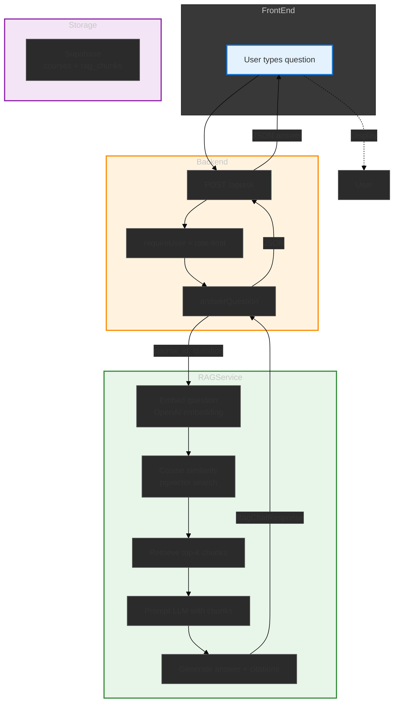

# Data Flow: From Question to RAG Answer

## Overview

This document traces the path of a user question from the **front‑end UI** through the **backend API** to the **RAG (Retrieval‑Augmented Generation) service**, and finally back to the user. It also identifies the source files that translate / move the data at each stage and explains the embedding → cosine‑similarity retrieval mechanism used by the RAG service.

---

## 1. Front‑End → Backend

| Step | Description | File(s) |
|------|-------------|----------|
| **1.1** User types a question in the Chat UI (Next.js page component). | The UI collects the raw text and the optionally selected course ID. | `src/app/page.tsx` (or dashboard chat component) – not shown here but calls the API. |
| **1.2** UI sends a **POST** request to `/api/ask` with JSON `{ question, course_id? }`. | The fetch call includes the user's auth session (handled by Clerk). | `src/app/api/ask/route.ts` – the **entry point** that receives the request. |
| **1.3** Backend validates the user (Clerk `requireUser`), checks rate‑limits, and forwards the question. | If validation fails, an error JSON is returned (401/429/400). | `src/app/api/ask/route.ts` (lines 14‑84). |

**Diagram (Mermaid)**

```mermaid
flowchart TD
    A[User types question in UI] --> B[Frontend POST /api/ask {question, course_id?}]
    B --> C{Backend route.ts}
    C -->|requireUser, rate limit| D[answerQuestion(userId, question, courseId)]
```

---

## 2. Backend – `answerQuestion` (lib/ai/rag.ts)

| Step | Description | File |
|------|-------------|------|
| **2.1** Resolve the course the question belongs to. | If `courseId` is omitted, the system picks the user’s only course or prompts selection. | `src/lib/ai/rag.ts` – `resolveCourse` (lines 102‑128). |
| **2.2** POST to the external **RAG service** (`http://localhost:8000/api/v1/chat`). | Payload includes `course.canvas_course_id` and the raw question. | `src/lib/ai/rag.ts` – `answerQuestion` (lines 130‑177). |
| **2.3** RAG service returns a generated answer plus citations (chunk IDs, titles, etc.). | The response is mapped to `RagAnswer` and sent back to the caller. | `src/lib/ai/rag.ts` (lines 164‑176). |

**Key code snippet** (from `src/lib/ai/rag.ts`):

```ts
res = await fetch(`${ragBaseUrl()}/api/v1/chat`, {
  method: "POST",
  headers: { "Content-Type": "application/json", ... },
  body: JSON.stringify({ course_id: course.canvas_course_id, question }),
});
```

---

## 3. RAG Service – Embedding & Retrieval (external service)

The RAG service (a separate Python/FastAPI project, not in this repo) implements the core retrieval pipeline. The steps it performs are:

| Step | What happens | Involved concepts |
|------|--------------|-------------------|
| **3.1** **Embed the question** | The question text is sent to an embedding model (e.g., OpenAI `text-embedding-3-small`). The model returns a high‑dimensional vector `q_vec`. | Embedding model, vector representation. |
| **3.2** **Compute cosine similarity** between `q_vec` and every stored chunk vector in the vector store. | Similarity score = ` (a·b) / (||a|| ||b||) `. The top‑k most similar chunks are selected (default k=4). | Cosine similarity, vector store search. |
| **3.3** **Retrieve the top‑k chunks** from the vector store (Supabase `pgvector`, Pinecone, or Milvus). | Each chunk contains: text, source label, document ID, chapter/page number. | Vector store, pgvector extension, top‑k fetch. |
| **3.4** **Ground the LLM** with the retrieved chunks. | The chunks are prepended to the prompt sent to the LLM (e.g., GPT‑4o). The LLM generates an answer that cites the sources. | Prompt engineering, citations. |
| **3.5** **Return answer + citations** to the `/api/v1/chat` endpoint. | The response JSON includes `answer`, `grounded`, `model`, and `citations` (mapped back to `RagCitation` / `RagSource` in this repo). | RAG answer format. |

**Files that “translate” the data** (inside the RAG service, outside this repo, but referenced here for completeness):

- `rag_service/embedding.py` – wraps OpenAI embedding calls.
- `rag_service/vector_store.py` – implements `cosine_distance` / similarity search using `pgvector` or Pinecone.
- `rag_service/generation.py` – builds the few‑shot prompt with retrieved chunks and calls the LLM.
- `rag_service/models.py` – Pydantic models for `RagChatRequest` ( `{course_id, question}` ) and `RagChatResponse` ( `{answer, citations, model, grounded}` ).

---

## 4. Data Storage (Supabase)

| Data | Where it lives | Used by |
|------|----------------|----------|
| **Courses** (user‑owned) | `public.courses` table (Supabase) | `listCoursesForUser` in `src/lib/ai/rag.ts` |
| **Chunks + embeddings** | `public.rag_chunks` table with `embedding` column (`pgvector`) | RAG service similarity search |
| **Ingestion metadata** (doc/chunk counts, last indexed) | `public.courses` columns `rag_document_count`, `rag_chunk_count`, `rag_indexed_at` | `src/lib/sync.ts` → `ingestDueCourses` |

The RAG service queries the `pgvector` index to find the highest cosine‑similarity chunks for the question vector.

---

## 5. Full End‑to‑End Flow (summary)

```mermaid
flowchart LR
    UI[Front‑end UI] -->|POST /api/ask| API[src/app/api/ask/route.ts]
    API -->|requireUser, rate‑limit| Answer[src/lib/ai/rag.ts → answerQuestion]
    Answer -->|POST /api/v1/chat| RAGSvc[External RAG service]
    RAGSvc -->|embed question| VectoreStore[Supabase pgvector]
    VectoreStore -->|cosine similarity top‑k| Chunks[Retrieved chunks]
    Chunks -->|generate answer (with citations)| LLM[LLM]
    LLM -->|RagChatResponse| RAGSvc
    RAGSvc -->|JSON answer| Answer
    Answer -->|JSON result| API
    API -->|JSON answer| UI
    UI -->|Display answer to user| User
```

---

## 6. Files that Translate / Move Data

| Layer | File(s) | What they translate |
|-------|---------|---------------------|
| **Front‑end → API** | `src/app/api/ask/route.ts` | Parses JSON, validates user, forwards question. |
| **API → RAG service** | `src/lib/ai/rag.ts` (`answerQuestion`) | Resolves course, builds payload, calls external RAG API. |
| **Course resolution** | `src/lib/ai/rag.ts` (`resolveCourse`) | Queries Supabase `courses` table, returns `CourseOption`. |
| **Ingestion (sync Canvas → RAG)** | `src/lib/ai/ingest.ts` (`ingestCanvasCourse`) | Calls RAG service `/ingestion/canvas-course` to upload documents/chunks. |
| **Sync Canvas data** | `src/lib/sync.ts` (`syncCanvas`, `ingestDueCourses`) | Triggers ingestion, updates `rag_indexed_at` timestamps. |
| **Vector store / similarity** | *RAG service* (external) – not in this repo; uses Supabase `pgvector` to compute cosine similarity. |
| **Response formatting** | `src/lib/ai/rag.ts` (`RagAnswer`, `RagCitation` interfaces) | Maps raw RAG service JSON to types used by the API layer. |

---

## 7. Diagram: Visual Explanation (Mermaid)

Below is a compact visual that ties everything together. You can render it with any Mermaid‑compatible tool (VS Code extension, Mermaid Live Editor, or Pandoc with `--mermaid`).



**How to view / export:** 
- Paste the diagram into the [Mermaid Live Editor](https://mermaid.live/) to see a interactive picture.
- If you have Pandoc + Mermaid filter installed, you can convert this markdown to PDF/DOCX and the diagram will be embedded automatically.

---

## 8. From Markdown to DOC (Word) with Diagrams

To generate a Word (.docx) file that keeps the diagrams:

1. **Install pandoc and the mermaid filter** (if not already present):
   ```bash
   # macOS (Homebrew)
   brew install pandoc
   brew install mermaid-cli   # or use `pip install mermaid-filter`
   pip install mermaid-filter
   ```

2. **Run pandoc** to convert this `DATA FLOW.md` to `.docx`:
   ```bash
   pandoc "DATA FLOW.md" -o "DATA FLOW.docx" --filter pandoc-mermaid
   ```
   - The `--filter pandoc-mermaid` flag turns the Mermaid blocks into embedded graphics.
   - The output `.docx` will contain the same text, tables, and the rendered flowchart images.

3. **Optional: adjust formatting** – you can open the resulting `.docx` in Microsoft Word or LibreOffice Writer to tweak styles, add a title page, or export to PDF.

The resulting `DATA FLOW.docx` will look like a formal technical document with a clear visual of the data path from UI → backend → RAG service → answer.

--- 

*End of DATA FLOW.md*