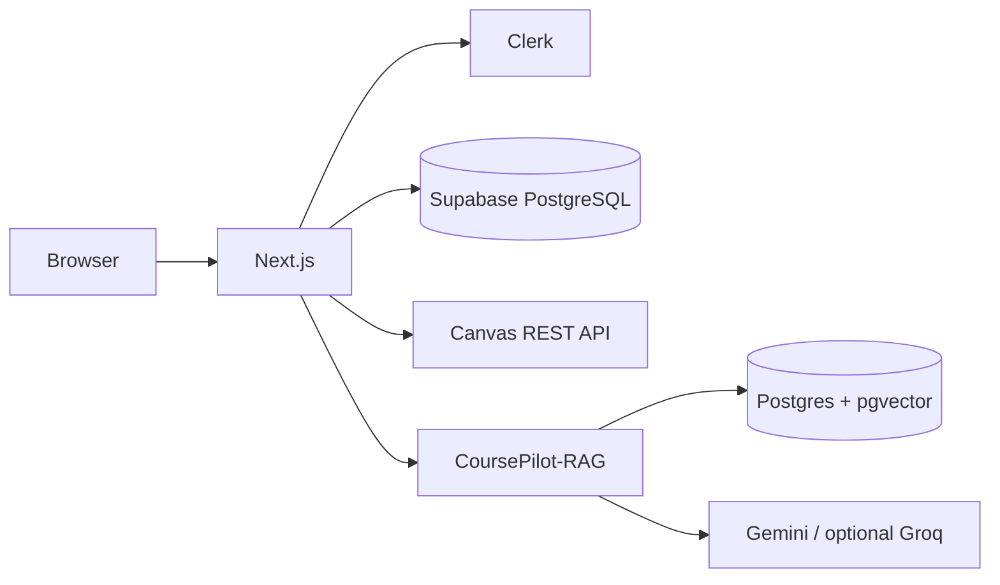

# CoursePilot

AI-powered academic dashboard for Canvas LMS. CoursePilot centralizes courses,
tasks, announcements, deadline changes, and course-scoped AI assistance.

> Status: working local demo. Hosted deployment remains pending.

## Features

- Clerk authentication and protected dashboard
- Encrypted per-user Canvas personal access tokens
- Canvas course, assignment, and announcement synchronization
- Deadline-change detection and deterministic task priorities
- Manual academic tasks and chat history
- RAG assistant with citations
- Canvas module ingestion through [CoursePilot-RAG](https://github.com/w1iii/CoursePilot-RAG)
- Optional scheduled synchronization

## Architecture



The web app owns authentication, Canvas metadata, tasks, announcements, chat
history, and settings. RAG owns document ingestion, embeddings, retrieval, and
cited answers.

## Stack

- Next.js 15 App Router, React 19, TypeScript, Tailwind CSS 4
- Clerk authentication
- Supabase PostgreSQL with SQL/Supabase Query Builder; no ORM
- Canvas REST API
- External FastAPI RAG service with SQLAlchemy and pgvector

## Quick start

### Prerequisites

Node.js 20+, Supabase, Clerk, Canvas access, Python 3.12+, `uv`, and PostgreSQL
with pgvector. Tesseract is optional for OCR.

```bash
git clone https://github.com/w1iii/CoursePilot.git
git clone https://github.com/w1iii/CoursePilot-RAG.git

cd CoursePilot
npm ci
cp .env.example .env
```

Run [`supabase/schema.sql`](supabase/schema.sql) in Supabase. Create a Clerk
application and fill its keys. Generate `TOKEN_ENCRYPTION_KEY` with:

```bash
node -e "console.log(require('crypto').randomBytes(32).toString('base64'))"
```

Start RAG in another terminal:

```bash
cd ../CoursePilot-RAG
uv sync
cp .env.example .env
uv run uvicorn app.main:app --reload --port 8000
```

Then start CoursePilot:

```bash
cd ../CoursePilot
npm run dev
```

Open `http://localhost:3000`, sign in, connect Canvas from Settings, and sync.
`RAG_SIGNING_SECRET` must match in both services.

## Configuration

Copy `.env.example` to `.env`; never commit secrets.

| Variable | Required | Default | Purpose |
| --- | --- | --- | --- |
| `NEXT_PUBLIC_CLERK_PUBLISHABLE_KEY` | Yes | — | Clerk browser key |
| `CLERK_SECRET_KEY` | Yes | — | Clerk server key |
| `NEXT_PUBLIC_CLERK_SIGN_IN_URL` | No | `/sign-in` | Sign-in route |
| `NEXT_PUBLIC_CLERK_SIGN_UP_URL` | No | `/sign-up` | Sign-up route |
| `SUPABASE_URL` | Yes | — | Supabase URL |
| `SUPABASE_SERVICE_ROLE_KEY` | Yes | — | Server-only database key |
| `CANVAS_API_URL` | No | `https://canvas.instructure.com` | Default Canvas host |
| `TOKEN_ENCRYPTION_KEY` | Yes | — | AES-256-GCM key |
| `CANVAS_ALLOW_ENV_TOKEN` | No | `false` | Local shared-token fallback |
| `CANVAS_ACCESS_TOKEN` | No | — | Local fallback token |
| `RAG_API_URL` | No | `http://localhost:8000` | RAG URL |
| `RAG_TIMEOUT_MS` | No | `30000` | Chat timeout |
| `RAG_SIGNING_SECRET` | Yes with RAG | — | Shared HMAC secret |
| `RAG_INGESTION_ENABLED` | No | `true` | Ingest during sync |
| `RAG_INGEST_MAX_COURSES` | No | `3` | Courses per sync |
| `RAG_REINDEX_HOURS` | No | `24` | Re-index interval |
| `RAG_INGEST_TIMEOUT_MS` | No | `180000` | Ingestion timeout |
| `RAG_INGEST_MAX_ATTEMPTS` | No | `2` | Ingestion retries |
| `RATE_LIMIT_PER_MINUTE` | No | `10` | Shared minute budget |
| `RATE_LIMIT_PER_DAY` | No | `200` | Shared daily budget |
| `CACHE_ENABLED` | No | `true` | Next.js user-read cache |
| `CRON_SECRET` | For cron | — | Scheduled-sync authorization |
| `CRON_SYNC_MAX_USERS` | No | `5` | Users per cron request |

Production RAG URLs must use HTTPS. Local loopback HTTP is allowed.

## How it works

1. Clerk authenticates the student.
2. Canvas connection validates and encrypts the supplied token.
3. Sync upserts courses, assignments, announcements, and deadline changes.
4. Due courses send transient Canvas credentials to RAG for ingestion.
5. RAG parses, chunks, embeds, and stores course material in pgvector.
6. The assistant signs a short-lived token bound to the user and course.
7. RAG retrieves matching chunks and returns an answer with citations.

RAG ingestion supports Canvas Pages, Files, subheaders, assignment
descriptions, and quiz descriptions/questions. External URLs/tools, unknown
items, and unsupported files are skipped and reported. Failures do not roll
back Canvas metadata synchronization.

Task priority is deterministic: due date is the main signal, with extra weight
for exams, projects, and quizzes near their deadline.

## API surface

User routes require the signed-in Clerk user. The cron route uses `CRON_SECRET`.

| Method | Path | Purpose |
| --- | --- | --- |
| `POST` | `/api/canvas/connect` | Validate and store encrypted Canvas token |
| `GET` | `/api/canvas/status` | Return connection status; never token |
| `POST` | `/api/canvas/disconnect` | Remove Canvas connection |
| `POST` | `/api/sync` | Sync Canvas and due RAG courses |
| `GET/POST` | `/api/tasks` | List or create tasks |
| `PATCH/DELETE` | `/api/tasks/:id` | Update or delete manual task |
| `POST` | `/api/ask` | Ask assistant and receive citations |
| `GET` | `/api/threads` | List chat threads |
| `GET/PUT/DELETE` | `/api/threads/:id` | Load, save, or delete thread |
| `GET` | `/api/cron/sync` | Batch-sync healthy Canvas accounts |

`vercel.json` schedules cron at `0 6 * * *`. The cron secret may be sent as a
Bearer token or `x-cron-secret` header. Rate-limit budgets return `429` with
`Retry-After`; unavailable limiter infrastructure returns `503`.

## Database

Run `supabase/schema.sql` before deployment. It defines `users`,
`canvas_accounts`, `courses`, `academic_tasks`, `announcements`,
`deadline_changes`, `ai_requests`, `rate_limit_windows`, `chat_threads`, and
`chat_messages`, plus `check_rate_limit()` and `save_chat_thread()` RPCs.

Row Level Security is enabled. The service-role key stays server-side.

## Project layout

```text
src/
  middleware.ts                 Clerk protection for dashboard pages
  app/dashboard/                Dashboard, settings, assistant, tasks
  app/api/                      Canvas, sync, cron, tasks, ask, threads
  lib/canvas.ts                 Canvas client and network validation
  lib/canvas-account.ts         Encrypted per-user credentials
  lib/sync.ts                   Canvas metadata + RAG pipeline
  lib/ai/                       RAG client, ingestion, tokens, logging
  lib/priority.ts               Task/announcement scoring
  lib/rate-limit.ts             Postgres-backed limits
  lib/cache.ts                  User-scoped Next.js cache
supabase/schema.sql             Database schema and RPCs
```

## Security and operations

- Canvas tokens use AES-256-GCM and are never returned to clients.
- RAG uses short-lived HMAC tokens bound to user, course, and scope.
- Canvas requests validate public addresses and restrict redirects.
- Production RAG communication requires HTTPS.
- CSP, frame, referrer, and permissions headers are configured.
- Review [`REMAINING_SYSTEM_HARDENING.md`](REMAINING_SYSTEM_HARDENING.md) before deploy.
- Follow the [system operations runbook](../docs/SYSTEM_OPERATIONS.md) for CI,
  staging promotion, rollback, and launch checks.

## Development commands

```bash
npm run dev
npm run lint
npm run test
npx tsc --noEmit
npm run build
```

Tests use Vitest and mock external services where appropriate.

## Troubleshooting

- **Canvas 401:** reconnect with a valid token and confirm the Canvas host.
- **No courses:** connect Canvas, then run sync from the dashboard.
- **Assistant unavailable:** verify RAG is running and signing secrets match.
- **No RAG context:** inspect sync results for ingestion failures/skips.
- **OCR failure:** install Tesseract (`brew install tesseract` on macOS).
- **Cron 401/503:** configure `CRON_SECRET` and send the expected header.

## Limitations and roadmap

Canvas OAuth, hosted RAG, and Vercel deployment remain pending. Ingestion is
capped per sync to control latency and embedding usage.

## Related documentation

- [CoursePilot-RAG](https://github.com/w1iii/CoursePilot-RAG)
- [`docs/CoursePilot.md`](docs/CoursePilot.md) — original academic brief
- [`PROGRESS.md`](PROGRESS.md)
- [`REMAINING_SYSTEM_HARDENING.md`](REMAINING_SYSTEM_HARDENING.md)
