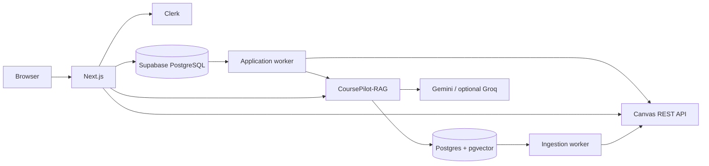

# CoursePilot

AI-powered academic dashboard for Canvas LMS. CoursePilot centralizes courses,
tasks, announcements, deadline changes, and course-scoped AI assistance.

> **Status — 27 November 2026:** [hosted frontend](https://course-pilot-pi.vercel.app)
> has verified READY deployment metadata. Current RAG/worker attribution and
> authenticated production CRUD/AI acceptance remain **Not Verified**.

## Technical handoff and review

- **[Revised technical handoff](docs/FINAL_TECHNICAL_HANDOFF_REVISED.md)** ·
  **[3-page PDF](docs/FINAL_TECHNICAL_HANDOFF_REVISED.pdf)** ·
  **[Word](docs/FINAL_TECHNICAL_HANDOFF_REVISED.docx)**
- **[System review](docs/SYSTEM_REVIEW.md)** — architecture, ERD, API contracts,
  six diagrams, findings, operations, and defense Q&A
- [Audit evidence](docs/audit-evidence/README.md) ·
  [Measured evaluation](docs/audit-evidence/offline-stream-benchmark.md) ·
  [AI security implementation](docs/audit-evidence/AI_SECURITY_IMPLEMENTATION.md) ·
  [Owner-supplied ERD context](docs/audit-evidence/SCHEMA_CONTEXT.md)
- [Audited main CI](https://github.com/w1iii/CoursePilot/actions/runs/45988132144)

Documents and supporting evidence now live **inside this repository** under
`docs/`. Relative links work locally; new GitHub/PDF evidence URLs require an
approved commit/merge/push before reviewers can open them online. Accessible
Google Doc and submission remain pending. Original workspace audit files are
preserved; historical integrity records predate these authorized documentation edits.

## Features

- Clerk authentication and protected dashboard
- Encrypted per-user Canvas personal access tokens
- Canvas course, assignment, and announcement synchronization
- Deadline-change detection and deterministic task priorities
- Manual academic tasks and chat history
- RAG assistant with citations
- Canvas module ingestion through [CoursePilot-RAG](https://github.com/w1iii/CoursePilot-RAG)
- Optional scheduled synchronization
- Study packs from one or two indexed modules, with saved practice sessions
- Server-scored MCQ attempts; self-assessed flashcards/short answers
- Durable synchronization/study jobs and persistent in-app notifications
- Optional bounded streaming chat with navigation-safe response state

## Architecture



The web app owns authentication, Canvas metadata, tasks, announcements, chat
history, study packs/sessions, settings, and application jobs. RAG owns ingestion,
embeddings, retrieval, cited answers, structured study generation, and its own
ingestion queue. Both workers run separately from the HTTP processes.

## Stack

- Next.js 15 App Router, React 19, TypeScript, Tailwind CSS 4
- Clerk authentication
- Supabase PostgreSQL with SQL/Supabase Query Builder; no ORM
- Canvas REST API
- External FastAPI RAG service with SQLAlchemy and pgvector

## Quick start

### Prerequisites

Node.js 22 or later (CI tests 22 and 26), Supabase, Clerk, Canvas access,
Python 3.12 or 3.13, `uv`, and PostgreSQL
with pgvector. Tesseract is optional for OCR.

```bash
git clone https://github.com/w1iii/CoursePilot.git
git clone https://github.com/w1iii/CoursePilot-RAG.git

cd CoursePilot
npm ci
cp .env.example .env
```

If using nvm, run `nvm install` and `nvm use` in this directory first. Use
separate development Supabase and Clerk projects and a Canvas test account; do
not reuse production credentials or user data.

For a **new disposable development database**, review
[`supabase/schema.sql`](supabase/schema.sql) and ordered
[`migrations/`](supabase/migrations/). Baseline alone omits newer study, deletion,
queue, and readiness contracts. Reconcile migration history and destinations
before applying anything to an existing database; do not blindly replay SQL
against live data. A historical vector migration exists despite separate RAG storage.

Create a dedicated Clerk development application and fill its keys.
Generate `TOKEN_ENCRYPTION_KEY` with:

```bash
node -e "console.log(require('crypto').randomBytes(32).toString('base64'))"
```

Start RAG in another terminal:

```bash
cd ../CoursePilot-RAG
uv sync --locked --all-groups
cp .env.example .env
uv run uvicorn app.main:app --reload --port 8000
```

Before starting RAG, follow its README to initialize an isolated pgvector
database and fill all required configuration. Never use staging or production.
Configure matching `RAG_JOB_ENCRYPTION_KEY` on RAG API and ingestion worker.

Then start CoursePilot:

```bash
cd ../CoursePilot
npm run dev
```

Start both workers in separate terminals:

```bash
# From CoursePilot; use the environment file created above.
node --env-file=.env --import tsx scripts/job-worker.ts
```

```bash
# From CoursePilot-RAG
uv run --env-file .env python -m app.ingestion.worker
```

Open `http://localhost:3000`, sign in, and complete Canvas onboarding/course
selection. `RAG_SIGNING_SECRET` must match across web, application worker, and
RAG. Standalone app worker does not load Next.js environment files automatically.
Deploy web/app worker from compatible revisions; study jobs require readiness.
See [background jobs](docs/BACKGROUND_JOBS.md) and
[study reliability](docs/STUDY_PREP_RELIABILITY.md).

## Configuration

Copy `.env.example` to `.env`; never commit secrets.

| Variable | Required | Default | Purpose |
| --- | --- | --- | --- |
| `NEXT_PUBLIC_CLERK_PUBLISHABLE_KEY` | Yes | — | Clerk browser key |
| `CLERK_SECRET_KEY` | Yes | — | Clerk server key |
| `NEXT_PUBLIC_CLERK_SIGN_IN_URL` | No | `/sign-in` | Sign-in route |
| `NEXT_PUBLIC_CLERK_SIGN_UP_URL` | No | `/sign-up` | Sign-up route |
| `SUPABASE_URL` | Yes | — | Supabase URL |
| `SUPABASE_SERVICE_ROLE_KEY` | Yes | — | Server-only database key |
| `CANVAS_API_URL` | No | `https://canvas.instructure.com` | Default Canvas host |
| `TOKEN_ENCRYPTION_KEY` | Yes | — | AES-256-GCM key |
| `CANVAS_ALLOW_ENV_TOKEN` | No | `false` | Local shared-token fallback |
| `CANVAS_ACCESS_TOKEN` | No | — | Local fallback token |
| `RAG_API_URL` | No | `http://localhost:8000` | RAG URL |
| `RAG_TIMEOUT_MS` | No | `35000` | Legacy JSON RAG timeout, capped at 35 seconds |
| `RAG_CHAT_STREAM_ENABLED` | No | `false` | Enable budgeted streaming after matching RAG deployment |
| `RAG_SIGNING_SECRET` | Yes with RAG | — | Shared HMAC secret |
| `RAG_INGESTION_ENABLED` | No | `true` | Ingest during sync |
| `RAG_INGEST_MAX_COURSES` | No | `3` | Courses per sync |
| `RAG_REINDEX_HOURS` | No | `24` | Re-index interval |
| `RAG_INGEST_TIMEOUT_MS` | No | `180000` | Ingestion timeout |
| `RAG_INGEST_MAX_ATTEMPTS` | No | `2` | Ingestion retries |
| `RATE_LIMIT_PER_MINUTE` | No | `10` | Shared minute budget |
| `RATE_LIMIT_PER_DAY` | No | `200` | Shared daily budget |
| `CACHE_ENABLED` | No | `true` | Next.js user-read cache |
| `CRON_SECRET` | For cron | — | Scheduled-sync authorization |
| `CRON_SYNC_MAX_USERS` | No | `5` | Users per cron request |

Production RAG URLs must use HTTPS. Local loopback HTTP is allowed.

## How it works

1. Clerk authenticates the student.
2. Canvas connection validates and encrypts the supplied token.
3. Onboarding/sync enqueue jobs; application worker upserts courses, assignments,
   announcements, and deadline changes.
4. Due courses enqueue RAG ingestion; queued credentials are encrypted and
   cleared on terminal completion.
5. RAG parses, chunks, embeds, and stores course material in pgvector.
6. The assistant signs a short-lived token bound to the user and course.
7. RAG retrieves matching chunks and returns an answer with citations.
8. Study creation validates one/two modules and 1–15 items, returns `202`, and
   worker saves validated packs/items transactionally. UI polls persisted jobs.

`grounded` signals retrieved chunks, not measured factual accuracy. Chat may
offer labeled course-topic fallback/search when material is insufficient.
No custom model training or fine-tuning is implemented.

RAG ingestion supports Canvas Pages, Files, subheaders, assignment
descriptions, and quiz descriptions/questions. External URLs/tools, unknown
items, and unsupported files are skipped and reported. Failures do not roll
back Canvas metadata synchronization.

Task priority is deterministic: due date is the main signal, with extra weight
for exams, projects, and quizzes near their deadline.

## API surface

User routes require the signed-in Clerk user. The cron route uses `CRON_SECRET`.

| Method | Path | Purpose |
| --- | --- | --- |
| `POST` | `/api/canvas/connect` | Validate and store encrypted Canvas token |
| `GET` | `/api/canvas/status` | Return connection status; never token |
| `POST` | `/api/canvas/disconnect` | Remove Canvas connection |
| `POST` | `/api/sync` | Queue Canvas/RAG synchronization (`202`) |
| `POST` | `/api/sync/courses/:courseId` | Queue owned-course synchronization |
| `GET/POST` | `/api/tasks` | List or create tasks |
| `PATCH/DELETE` | `/api/tasks/:id` | Update owned task; delete manual task only |
| `POST` | `/api/ask` | Ask assistant and receive citations |
| `GET` | `/api/threads` | List chat threads |
| `GET/PUT/DELETE` | `/api/threads/:id` | Load, save, or delete thread |
| `GET` | `/api/cron/sync` | Enqueue bounded batch synchronization |
| `GET/POST` | `/api/study-packs` | List packs / queue generation (`202`) |
| `GET/DELETE` | `/api/study-packs/:id` | Read/delete owned pack |
| `GET/POST` | `/api/study-packs/:id/sessions` | List/start practice sessions |
| `GET/PATCH` | `/api/study-sessions/:id` | Read/update owned session |
| `POST` | `/api/study-sessions/:id/attempts` | Save attempt; compute MCQ correctness |
| `GET/POST` | `/api/jobs` | List active/unread results / revalidate user cache |
| `GET/PATCH` | `/api/jobs/:jobId` | Read status / dismiss terminal notification |
| `DELETE` | `/api/account` | Confirmed app-data deletion then Clerk deletion |

Selected surface only: onboarding, course selection, module metadata, profile,
session deletion, and secret-protected metrics routes also exist.
`POST /api/jobs` does not submit arbitrary work.

`vercel.json` schedules cron at `0 6 * * *`. The cron secret may be sent as a
Bearer token or `x-cron-secret` header. Rate-limit budgets return `429` with
`Retry-After`; unavailable limiter infrastructure returns `503`.

## Database

The baseline `supabase/schema.sql` defines `users`,
`canvas_accounts`, `courses`, `academic_tasks`, `announcements`,
`deadline_changes`, `ai_requests`, `rate_limit_windows`, `chat_threads`, and
`chat_messages`, plus `check_rate_limit()` and `save_chat_thread()` RPCs.

Ordered migrations add study packs/items/sessions/attempts, deletion tombstones,
durable jobs, readiness, and reliability/answer-validation RPCs. Verify the full
contract before deploying web and worker code.

RLS is enabled in source SQL. Server service-role access bypasses it; explicit
handler/RPC ownership checks remain essential. Deployed grants/ledger were not
independently inspected.

## Project layout

```text
src/
  middleware.ts                 Clerk protection for dashboard pages
  app/dashboard/                Dashboard, settings, assistant, tasks
  app/api/                      Canvas, sync, cron, tasks, ask, threads
  lib/canvas.ts                 Canvas client and network validation
  lib/canvas-account.ts         Encrypted per-user credentials
  lib/sync.ts                   Canvas metadata + RAG pipeline
  lib/ai/                       RAG client, ingestion, tokens, logging
  lib/priority.ts               Task/announcement scoring
  lib/rate-limit.ts             Postgres-backed limits
  lib/cache.ts                  User-scoped Next.js cache
supabase/schema.sql             Database schema and RPCs
```

## Security and operations

- Canvas tokens use AES-256-GCM and are never returned to clients.
- RAG uses short-lived HMAC tokens bound to user, course, and scope.
- Canvas requests validate public addresses and restrict redirects.
- Production RAG communication requires HTTPS.
- Security headers are configured; global CSP is report-only and a narrower
  legacy route policy is enforced, not uniform enforced CSP.
- Review [`REMAINING_SYSTEM_HARDENING.md`](REMAINING_SYSTEM_HARDENING.md) before deploy.
- Follow [beta operations](docs/BETA_OPERATIONS.md) and
  [background jobs](docs/BACKGROUND_JOBS.md); dated deployment records do not
  establish current worker health.
- Account deletion does not orchestrate RAG cleanup/cancellation; complete
  cross-store erasure is not established.

## Development commands

```bash
npm run dev
npm run lint
npm run test
npm run typecheck
npm test -- --coverage
node --test scripts/staging-auth-smoke.test.mjs
npm run test:study-db
npm run build
```

Tests use Vitest and mock external services where appropriate.
`test:study-db` requires Docker/disposable databases, never live database URLs.
`npm run worker` requires environment injection.

### Verification snapshot — 27 November 2026

- Isolated local run: **370 Vitest tests passed** across 65 files; **3 smoke-unit
  tests passed**; lint/typecheck/build passed. npm audit reported zero advisories.
- Default coverage: **63.27% lines**, scoped to `src/lib`, not whole UI.
- Audited main CI passed Node 22/26 and study database-contract checks.
  Local DB run was blocked by unavailable Docker daemon.
- Main branches were unprotected; inspected PR review lists were empty.
  Passing CI does not prove enforced merge/deploy gating.

Results are dated software checks, not live AI-quality or deployed acceptance.
See [testing guide](TESTING.md) and [CI configuration](.github/workflows/ci.yml).

## Troubleshooting

- **Canvas 401:** reconnect with a valid token and confirm the Canvas host.
- **No courses:** connect Canvas, then run sync from the dashboard.
- **Assistant unavailable:** verify RAG is running and signing secrets match.
- **No RAG context:** inspect sync results for ingestion failures/skips.
- **Work stays queued:** check both workers, migrations, leases, and study readiness.
  Closing browser does not cancel durable jobs.
- **OCR failure:** install Tesseract (`brew install tesseract` on macOS).
- **Cron 401/503:** configure `CRON_SECRET` and send the expected header.

## Limitations and roadmap

Canvas OAuth is not implemented; connection uses personal access tokens.
Hosted frontend and RAG deployment-success metadata were observed, but current
API/worker identity, authenticated acceptance, costs/tiers, and deployed schema
remain unverified.

Known audit gaps: account deletion omits RAG cleanup; buffered JSON chat drops
web-source metadata preserved by streaming; deadline-event logging is not atomic
with task updates; study archive listing accumulates all history. Representative
AI-quality evaluation and complete current backup/restore evidence are missing.
Ingestion limits control work, not currency spending. Historical pitch/runbooks
may describe earlier behavior; consult dated evidence and current source.

## Related documentation

- [CoursePilot-RAG](https://github.com/w1iii/CoursePilot-RAG)
- [`docs/CoursePilot.md`](docs/CoursePilot.md) — original academic brief
- [`PROGRESS.md`](PROGRESS.md)
- [`REMAINING_SYSTEM_HARDENING.md`](REMAINING_SYSTEM_HARDENING.md)
