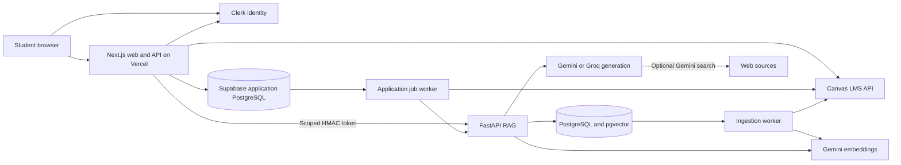
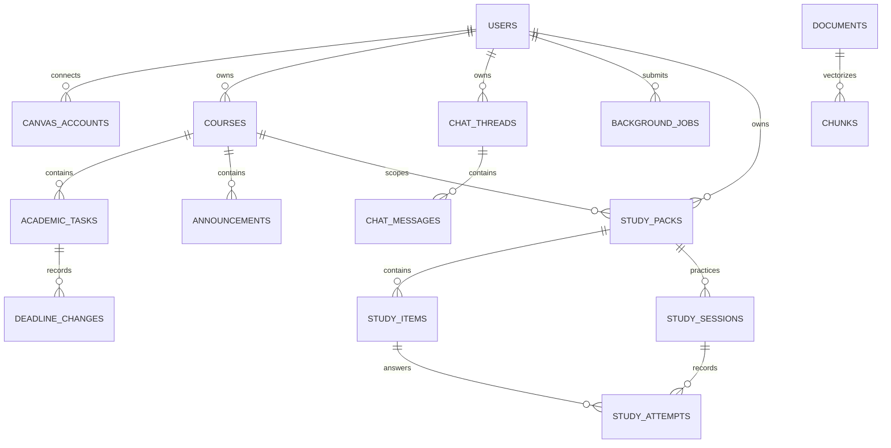
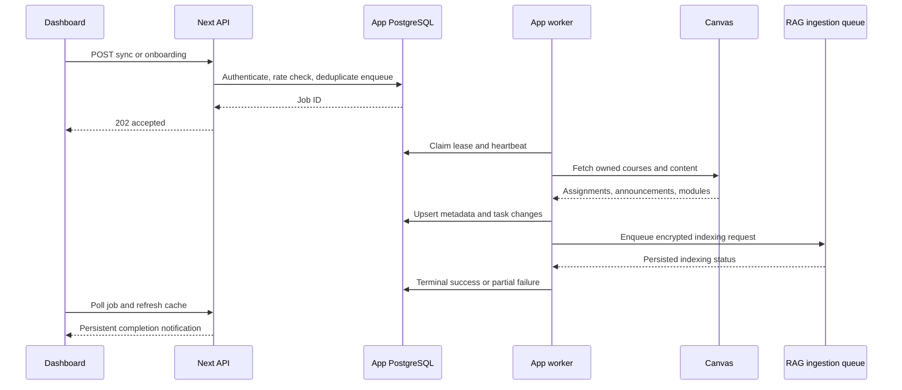
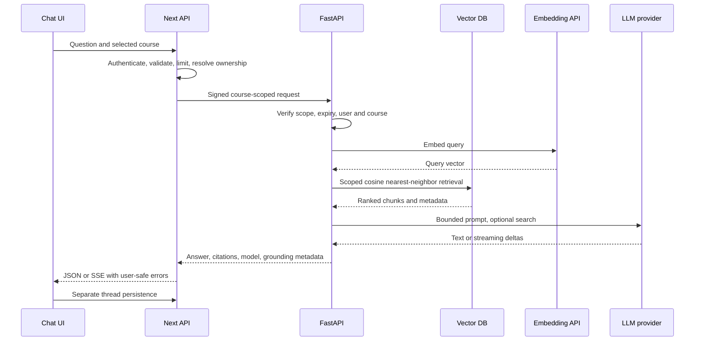
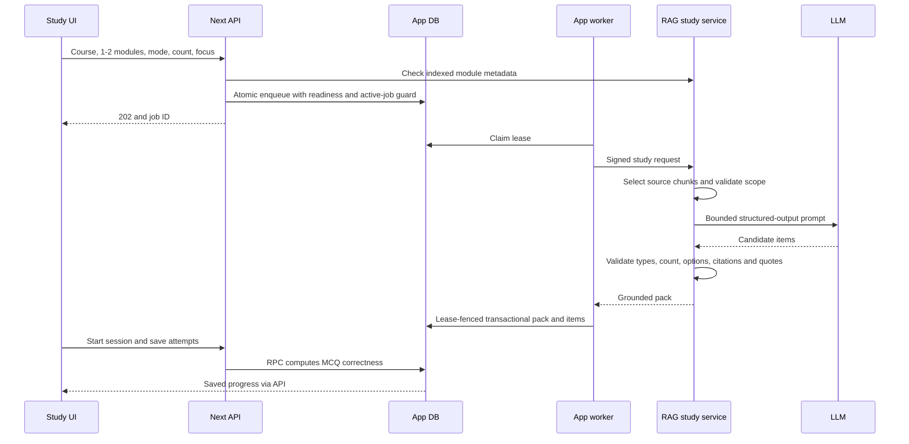
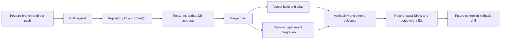

# CoursePilot — System Review and Defense Reference

> **Documentation addendum — 27 November 2026:** this review preserves the dated
> audit below. Current repository-local artifacts and acceptance actions are
> indexed in [documentation](README.md), [deliverables](DELIVERABLES_CHECKLIST.md)
> and the [verification register](VERIFICATION_REGISTER.md). README handoff links
> and the DevOps pack now exist locally; publication and runtime acceptance remain
> separate owner actions. Historical labels and execution results are retained.

> **Repository evidence copy:** original audit records describe the pre-documentation source snapshot. README/docs additions are authorized later changes, not a claim of currently clean Git status. New `main/docs` links require publication; private RAG links require access.

**Audit date:** 27 November 2026. **Owner:** Lui Franz Lomugdang, BSCS 4C — **Solo Full-stack Developer and DevOps Engineer** (role confirmed by owner; name/section from [academic brief](https://github.com/w1iii/CoursePilot/blob/main/docs/CoursePilot.md)).

**Verdict:** Substantial, test-backed implementation; suitable for an evidence-qualified academic presentation. **Submission package incomplete** until Google-template copy, sharing, README link, release identification, and required recording are resolved. **Unrestricted production readiness Not Verified:** current RAG/worker attribution, cross-store deletion, recovery coverage, and authenticated acceptance evidence remain open.

Evidence labels used throughout:
- **Verified—source:** implemented in audited code; does not establish deployment behavior.
- **Verified—execution:** command, test, or platform metadata independently observed during this audit.
- **Documented:** repository record; not independently replayed.
- **Partial:** implemented path with a known gap.
- **Missing:** requested artifact or implementation absent from inspected evidence.
- **Not Verified / Requires Manual Confirmation:** evidence unavailable or owner decision required.

This review distinguishes fixtures from live AI, historical records from current infrastructure, and merged PRs from independent approvals. Evidence capture began at **11:36 UTC / 19:36 Philippine time**. Deadline supplied: **27 November 2026, 23:59 Philippine time**.

## 1. Executive summary and product status

CoursePilot helps Canvas-using students consolidate courses, assignments, announcements, deadlines, course questions, and study practice. Clerk authenticates students; Next.js owns web/API behavior; Supabase stores application records; a separate FastAPI service indexes course material and generates answers/exercises.

| Capability | Assessment | Evidence / qualification |
|---|---|---|
| Sign-in, onboarding, username, Canvas connection | Verified—source and automated tests | Clerk + validated Canvas credentials; fresh authenticated production journey Not Verified |
| Course/assignment/announcement synchronization | Verified—source; partial-success handling | Durable jobs, Canvas pagination, per-user sync leases; external Canvas availability required |
| Manual task CRUD | Verified—source and tests | Owner-scoped create/read/update/delete; deployed CRUD recording Missing |
| Course assistant | Real provider integration, verified with fixtures | Retrieval, scoped tokens, model calls, citations, JSON/SSE paths; paid/live inference not run |
| Study packs and practice | Real provider integration, verified with fixtures and CI database tests | One/two modules; queued generation; transactional persistence; MCQ server scoring |
| Background notifications | Verified—source and tests | Persistent job status/read state; browser polling rather than push messaging |
| Deployment | Frontend READY verified; RAG success metadata verified | Direct attribution of current RAG API and both workers Not Verified |
| AI quality / learning benefit | Not Verified | No labeled representative evaluation or controlled learning study found |
| Production recovery | Partial, Documented | One historical encrypted RAG staging restore; automated backups and current Supabase restore evidence Missing |

**Pitch drift:** [original brief](https://github.com/w1iii/CoursePilot/blob/main/docs/CoursePilot.md) mentions OpenAI/GPT-5 and AI priority scoring. Current code implements Gemini/Groq clients and **deterministic** task priority/announcement scoring. Study prep, durable workers, and streaming extend the implementation. Do not describe priority scoring as machine learning, the provider integration as model training, or historical design documents as current acceptance proof.

## 2. Audit scope, method, and provenance

Two nested Git repositories were audited; workspace root is **not** a Git repository. Requested `docs/` outputs are outside both repositories and are not automatically published by either.

| Repository | Audited local HEAD | Observed remote `main` | Correspondence |
|---|---|---|---|
| [Web, public](https://github.com/w1iii/CoursePilot) | `12a2855d40ca52b9dbc4631907898fa1a3b5fdc0` | `e351689499fd063d22b0128047e7d5c8e3f7a130` | Identical tree `276314716b916a4638fe6e23be68358610ec678e` |
| [RAG, private](https://github.com/w1iii/CoursePilot-RAG) | `c50770126f4f6c6a3d6120c56bfa6d6b0b41d494` | `142bcb1d65153dcb73ec174670ae443d0c3eb916` | Identical tree `10c1eb189f8ff6734c3f476b141d049fd406f85d` |

Both local branches: `fix/study-input-validation`. [Web PR #13](https://github.com/w1iii/CoursePilot/pull/13) and [RAG PR #7](https://github.com/w1iii/CoursePilot-RAG/pull/7) were merged. Different commit IDs reflect merges; identical Git trees support source correspondence, **not** equality of runtime secrets, schema, provider settings, or image contents.

Method: inspect routes/helpers/components, SQL and ORM definitions, queues, tests, manifests/locks, workflows, history, GitHub metadata, deployment metadata, and dated operations records. Verification ran against isolated tracked-source snapshots without project `.env` files, with synthetic configuration and existing dependencies. No application changes, dependency installation, production writes, paid inference, commits, pushes, or deployments were performed. Existing design/review documents were treated as historical references; November 18 and 23 observations are not silently carried forward.

Limitations: local Docker daemon unavailable; no live database queries or authenticated write-capable smoke tests; no complete browser accessibility audit; no provider-quality evaluation; no independent license audit of every asset; no production secret-value inspection. GitHub Projects access lacked `read:project`. Private repository access for panel members requires confirmation.

Primary audit records: [baseline hashes and versions](https://github.com/w1iii/CoursePilot/blob/main/docs/audit-evidence/baseline.json), [route/history inventory](https://github.com/w1iii/CoursePilot/blob/main/docs/audit-evidence/source-inventory.json), [GitHub snapshot](https://github.com/w1iii/CoursePilot/blob/main/docs/audit-evidence/github.json), [platform snapshot](https://github.com/w1iii/CoursePilot/blob/main/docs/audit-evidence/platforms.json), [derived metrics](https://github.com/w1iii/CoursePilot/blob/main/docs/audit-evidence/metrics-and-history.json), [CI test summaries](https://github.com/w1iii/CoursePilot/blob/main/docs/audit-evidence/ci-test-summaries.json). Source links below resolve relative to this workspace; immutable remote snapshots are linked above through commit IDs in §19.

## 3. Repository map and technology disclosure

| Location | Responsibility |
|---|---|
| `coursepilot/src/app/` | App Router pages, layouts, 28 API route files |
| `coursepilot/src/components/` | Shared and landing-page UI |
| `coursepilot/src/lib/` | Identity, Canvas, crypto, caching, rate limits, sync, jobs, AI bridge |
| `coursepilot/supabase/schema.sql`, `migrations/`, `tests/` | Baseline, 11 migrations, SQL contract tests |
| `coursepilot/scripts/job-worker.ts` | Standalone application worker entry point |
| `rag/canvas-ai-assistant/app/api/` | FastAPI contracts and scoped authorization |
| `app/ingestion/`, `app/services/` | Fetch, parse, clean, chunk, persist, durable ingestion |
| `app/embeddings/`, `app/vectorstore/`, `app/rag/` | Provider adapters, SQLAlchemy/pgvector retrieval, prompts and generation |
| RAG `migrations/`, `scripts/`, `tests/` | Four SQL migrations, operations, 29 Python test files |
| Each repository’s `.github/workflows/` | Active independent repository CI and monitoring |
| Workspace `.github/workflows/` | Reference configuration outside either Git root; not evidence of deployed CI |

Versions below are **lock-resolved**, unless labeled runtime. Full dependency disclosure: [package.json](https://github.com/w1iii/CoursePilot/blob/12a2855d40ca52b9dbc4631907898fa1a3b5fdc0/package.json), [package-lock.json](https://github.com/w1iii/CoursePilot/blob/12a2855d40ca52b9dbc4631907898fa1a3b5fdc0/package-lock.json), [pyproject.toml](https://github.com/w1iii/CoursePilot-RAG/blob/c50770126f4f6c6a3d6120c56bfa6d6b0b41d494/pyproject.toml), [uv.lock](https://github.com/w1iii/CoursePilot-RAG/blob/c50770126f4f6c6a3d6120c56bfa6d6b0b41d494/uv.lock).

| Layer | Actual technology and purpose |
|---|---|
| Frontend | TypeScript 5.9.3; Next.js 15.5.29; React/React DOM 19.3.0; Tailwind CSS 4.3.3; Anime.js 4.5.0 |
| Identity and app persistence | Clerk Next.js SDK 7.9.18; Supabase JS 2.118.0; PostgreSQL tables/functions/RLS |
| Web runtime | CI Node 22 and 26; worker image Node 22; local verification Node 26.7.0, npm 11.19.0 |
| RAG backend | Python requirement `>=3.12,<3.14`; local 3.13.16; Docker/CI 3.12; FastAPI 0.162.0; Uvicorn 0.54.0 |
| ORM / transport / validation | SQLAlchemy 2.1.6; psycopg 3.3.6; pgvector Python 0.5.1; HTTPX 0.28.1; Pydantic 2.14.1; cryptography 50.0.2 |
| Content ingestion | BeautifulSoup, pypdf, python-docx, python-pptx, openpyxl/xlrd; optional PyMuPDF/Pillow/pytesseract/Tesseract OCR |
| AI | Gemini embedding/generation HTTP APIs; Groq OpenAI-compatible generation; configured fallbacks and Gemini search tooling |
| Quality | Vitest 5.1.0, V8 coverage, ESLint 9.39.5, pytest 9.1.1, pytest-cov, Ruff 0.17.5; npm audit, CI pip-audit/Gitleaks/Trivy/CodeQL |
| Hosting / operations | Vercel web; Railway RAG/workers referenced in release evidence; Supabase app DB; Railway vector DB in historical backup evidence; Cloudflare R2 historical encrypted backup |

**Service tiers, current invoices, quotas, model billing, institutional data permissions:** Requires Manual Confirmation. A free-tier assumption is not a cost finding. Gemini/Groq are runtime services; no evidence supports a fixed production model version beyond configuration/response metadata. `.env.example` names example models including `gemini-3.6-flash`, fallback Gemini models, and `gemini-embedding-001` at 1,536 dimensions; these are **checked-in examples**, not captured production values. Historical backup reports PostgreSQL 17.11 and pgvector extension 0.8.7; CI uses pgvector/PostgreSQL 16. Current production engine versions Not Verified.

**Configuration contract:** web requires Clerk configuration, `SUPABASE_URL`/`SUPABASE_SERVICE_ROLE_KEY`, Canvas encryption/host settings and RAG endpoint/signing settings. RAG requires database URL, embedding provider/model/dimension, Gemini key, chunk size/overlap, retrieval top-k and LLM provider/model. Durable ingestion additionally requires `RAG_JOB_ENCRYPTION_KEY` on API and ingestion worker; app worker needs application DB access and compatible study protocol. These are variable names/categories, not deployed values. Follow checked-in [web example](https://github.com/w1iii/CoursePilot/blob/12a2855d40ca52b9dbc4631907898fa1a3b5fdc0/.env.example) and [RAG example](https://github.com/w1iii/CoursePilot-RAG/blob/c50770126f4f6c6a3d6120c56bfa6d6b0b41d494/.env.example), verifying source where old comments conflict.

**Future isolated setup:** select supported Node/Python; create separate synthetic databases and test identities; resolve dependencies from locks (`npm ci`, `uv sync --locked --all-groups`); validate baseline plus ordered migrations in disposable databases; configure both services and workers; run checks in §13 before an authorized end-to-end test. These installation/setup steps were **not** executed against the original repositories during this audit. The root workspace is a container for two repositories, not a single deployable monorepo.

## 4. Architecture and trust boundaries

Browser never needs Supabase service-role credentials, Canvas encryption keys, HMAC signing keys, or AI provider keys. Inspected Supabase SDK import is centralized in [server helper](https://github.com/w1iii/CoursePilot/blob/12a2855d40ca52b9dbc4631907898fa1a3b5fdc0/src/lib/supabase.ts); route handlers and server components mediate persistence. Browser-to-Canvas instructions are onboarding guidance, not delegated API credentials for direct client querying.

There are **two logical data stores**: application records and indexed content. Course identity crosses that boundary through an authorized course key and owner claims, not a cross-database foreign key. Default shared indexing is disabled in source configuration. Enabling sharing requires an institutional visibility decision; do not assume every enrolled student sees identical material.

Design trade-offs: separate RAG service isolates Python ingestion/provider concerns but adds deployment and data-deletion coordination. PostgreSQL queues avoid an additional broker but couple job availability to database availability. Server service-role access simplifies backend integration but makes explicit ownership checks essential. Caching improves repeated reads but requires invalidation and tenant-scoped keys.

## 5. User workflows and frontend behavior

**Sign-in/onboarding:** Clerk → server `requireUser()` → onboarding gate → username/Canvas connection → current Canvas course list → selected course validation → transactional onboarding enqueue. [Dashboard layout](https://github.com/w1iii/CoursePilot/blob/12a2855d40ca52b9dbc4631907898fa1a3b5fdc0/src/app/dashboard/layout.tsx), [onboarding UI](https://github.com/w1iii/CoursePilot/blob/12a2855d40ca52b9dbc4631907898fa1a3b5fdc0/src/app/onboarding/OnboardingFlow.tsx), [finish route](https://github.com/w1iii/CoursePilot/blob/12a2855d40ca52b9dbc4631907898fa1a3b5fdc0/src/app/api/onboarding/finish/route.ts). `GET /api/onboarding/courses` **upserts** course records; `requireUser()` also upserts application identity. Therefore authenticated GET requests are not assumed read-only.

**Dashboard:** task filters, completion toggles, priority changes, manual creation/deletion, announcements, deadline changes, and synchronization state. [TaskLedger](https://github.com/w1iii/CoursePilot/blob/12a2855d40ca52b9dbc4631907898fa1a3b5fdc0/src/app/dashboard/TaskLedger.tsx) paginates visible tasks; [dashboard helpers](https://github.com/w1iii/CoursePilot/blob/12a2855d40ca52b9dbc4631907898fa1a3b5fdc0/src/lib/dashboard.ts) compute deterministic summaries. Synced task edits can be overwritten by later sync; completion/notes are preserved by sync logic. Manual deletion is allowed; Canvas-sourced task deletion is rejected.

**Chat:** [ChatProvider](https://github.com/w1iii/CoursePilot/blob/12a2855d40ca52b9dbc4631907898fa1a3b5fdc0/src/app/dashboard/ChatProvider.tsx) lives at dashboard-layout scope so in-flight chat survives page navigation. It handles stream events, abort, retry/error state, and serialized thread saving. Reloaded unfinished turns become interrupted errors. Conversation persistence is separate from answer generation; saving history does not mean the full thread is sent as model context.

**Study prep:** indexed course → one/two modules with chunks → mode, difficulty, 1–15 items, optional topic → 202 queued response → persistent notification → generated pack → practice session → attempt and progress updates. Archive lists saved packs/sessions. MCQ correctness comes from server SQL; flashcards and short answers are self-assessed. [Creation UI](https://github.com/w1iii/CoursePilot/blob/12a2855d40ca52b9dbc4631907898fa1a3b5fdc0/src/app/dashboard/study-prep/study-prep-home.tsx), [practice UI](https://github.com/w1iii/CoursePilot/blob/12a2855d40ca52b9dbc4631907898fa1a3b5fdc0/src/app/dashboard/study-prep/%5BpackId%5D/session/%5BsessionId%5D/page.tsx).

**Settings:** Canvas disconnect, indexed-course selection, appearance preferences, username, and account deletion. Disconnect removes connection credentials, not necessarily all synchronized/indexed history. Account deletion has a separate cross-store gap (§11/§16).

Loading/error boundaries, disabled controls, input validation, retries, and reduced-motion-related code exist. Full keyboard, screen-reader, contrast, mobile-device, and cross-browser acceptance remain **Not Verified**.

## 6. API contracts and authorization

All web paths below are relative to the frontend origin. **U** = Clerk-authenticated user via `requireUser()`; account deletion uses Clerk auth directly. Ownership is enforced in handlers/helpers/RPCs. **S** = constant-time secret-header verification. JSON shape/UUID validation varies by endpoint; detailed source is authoritative. [Machine-readable route inventory](https://github.com/w1iii/CoursePilot/blob/main/docs/audit-evidence/source-inventory.json) records exported methods, source lines, tables, and RPCs.

| Method / route | Input and purpose | Success / principal failure behavior |
|---|---|---|
| `DELETE /api/account` | Clerk user; deletion confirmation | App-data RPC then Clerk deletion; partial external failure possible |
| `GET /api/admin/cache-metrics` | S; bounded `days` query | Aggregated metrics; 401 for invalid secret |
| `POST /api/ask` | U; `question`, optional `course_id`, streaming-only `continuation` | JSON answer or SSE; 400 invalid/ambiguous course, 429 limit, 502 provider, 504 timeout |
| `POST /api/canvas/connect` | U; Canvas URL/token | Validate approved public host and token, encrypt/save; 400/401 invalid connection, 429/503 limiter |
| `POST /api/canvas/disconnect` | U | Disconnect; `{connected:false}` |
| `GET /api/canvas/status` | U | Safe connection status; never decrypted token |
| `POST /api/courses/selection` | U; `courseId`, boolean `selected` | Enrollment/ownership checks; select/enqueue or deselect/RAG cleanup |
| `GET /api/cron/sync` | S | Bounded batch enqueue; scheduler endpoint is state-changing |
| `GET /api/jobs` | U | Up to 100 active/unread jobs; private/no-store |
| `POST /api/jobs` | U | Invalidate user web cache; **does not enqueue arbitrary jobs** |
| `GET /api/jobs/[jobId]` | U; owned job UUID | Job ID, kind and status; result appears in job listing |
| `PATCH /api/jobs/[jobId]` | U; owned job | Acknowledge terminal notification |
| `GET /api/onboarding/courses` | U + Canvas credentials | Fetch and upsert enrollment list |
| `POST /api/onboarding/finish` | U; unique `courseIds`, 1–100 UUIDs | Validate enrollment; transactional selection and queued onboarding |
| `PUT /api/profile/username` | U; 1–40 characters, no control/format characters | Updated username |
| `GET /api/study-packs` | U | Saved pack/session history; database pages collected into one response |
| `POST /api/study-packs` | U; course, mode, difficulty, count, `moduleIds`, topic | **202**, job metadata; 409 unindexed, 422 invalid scope, queue/readiness limits |
| `GET/DELETE /api/study-packs/[id]` | U; owned pack UUID | Pack/items or deletion |
| `GET/POST /api/study-packs/[id]/sessions` | U; owned pack | Session listing / transactional start RPC |
| `DELETE /api/study-packs/[id]/sessions/[sessionId]` | U; matching owned pack/session | Session deletion |
| `GET /api/study-prep/courses` | U | Available study courses |
| `GET /api/study-prep/courses/[courseId]/modules` | U; owned course | Indexed module metadata |
| `POST /api/study-prep/courses/[courseId]/modules/refresh` | U; owned course, origin validation | Metadata refresh; not blanket re-embedding |
| `GET/PATCH /api/study-sessions/[id]` | U; owned session, status/current item | Session/attempt state; update RPC validates transitions |
| `POST /api/study-sessions/[id]/attempts` | U; item, answer, self-assessment fields | Save validated attempt; MCQ correctness derived server-side |
| `POST /api/sync` | U | 202 background job; 429 rate budget, 503 unavailable limiter |
| `POST /api/sync/courses/[courseId]` | U; owned UUID | Course-scoped queued sync |
| `GET/POST /api/tasks` | U; list filters / validated task fields | Owned tasks / created manual task |
| `PATCH/DELETE /api/tasks/[id]` | U; owned task | Update / manual-only deletion |
| `GET /api/threads` | U | Owned thread summaries |
| `GET/PUT/DELETE /api/threads/[id]` | U; thread UUID, validated turns/course | Read / atomic thread-save RPC / delete |

This table splits methods on shared route files; it does not imply 31 distinct route files.

RAG prefix: `/api/v1`. Requests carry signed `X-RAG-Token` claims, scoped user/course/action, checked by [tokens.py](https://github.com/w1iii/CoursePilot-RAG/blob/c50770126f4f6c6a3d6120c56bfa6d6b0b41d494/app/security/tokens.py). Generic shared bearer-token configuration comments are not the current authorization contract.

| Method / path after prefix | Required scope | Contract |
|---|---|---|
| `POST /chat` | `chat` | Question/course claims → answer, citations, web sources, model, grounding metadata |
| `POST /chat/stream` | `chat` | Bounded SSE events, cancellation and terminal/error signaling |
| `POST /ingestion/canvas-module` | `ingest` | Bound Canvas/course/module request → ingestion result |
| `POST /ingestion/canvas-course` | `ingest` | Course ingestion / metadata-refresh behavior |
| `POST /ingestion/jobs/{job_id}` | `ingest` | 64-hex job ID, encrypted queued request; 202 |
| `GET /ingestion/jobs/{job_id}` | `ingest` | Owner/course-scoped job status |
| `DELETE /ingestion/course/{course_key}` | `delete` | Scoped course-index cleanup |
| `GET /courses/{course_key}/index-counts` | `metadata` | Index counts |
| `GET /courses/{course_key}/modules` | `metadata` | Indexed modules/chunk counts |
| `POST /study-prep` | `study-prep` | Validated selection → grounded structured items; 422 insufficient evidence |

`GET /health` is outside `/api/v1`; returns 503 if database readiness fails. It does **not** prove provider, worker, authentication, or end-to-end readiness. FastAPI’s default documentation endpoints are not counted as business APIs. No end-user administrator role is established by the secret-protected maintenance endpoints.

## 7. Database model, migrations, and integrity

Diagram is a selected logical ERD, not an exhaustive physical schema. `DOCUMENTS/CHUNKS` are in the RAG store; no cross-store FK is implied. Additional tables include `ai_requests`, rate-limit windows, sync locks, deletion tombstones, worker-readiness records, RAG `course_modules`, and `ingestion_jobs`.

- Application UUIDs identify users/courses/tasks. Clerk ID is unique on users. Canvas course uniqueness is `(user_id, canvas_course_id)`; Canvas task uniqueness is scoped by application course.
- Task types/status/priority use CHECK constraints. Canvas-removed content can be soft-marked through `removed_at`; user-owned cascades remove dependent application records.
- Chat writes use `save_chat_thread`; study writes/session updates/attempts use RPCs. New background study saves are lease-fenced and transactional rather than independent pack/item inserts.
- RAG documents store owner/course/module/source fingerprint and content. Chunks cascade from documents; `(document_id, chunk_index)` is unique. `Vector(config.embedding_dimension)` must match actual embeddings. Cosine HNSW index uses `m=16`, `ef_construction=64`; metadata indexes support scope filtering.
- RAG module composite identity includes module ID, course key, owner. Course keys coordinate tenant scope across stores.
- Schema baseline is **not** a complete fresh-install migration plan: study, deletion, queue/readiness and newer contracts arrive through migrations. `schema.sql:64` also performs selection backfill; replaying it is not purely declarative.
- Web includes a historical vector-table migration although baseline comments describe a separate RAG DB. Deployment destination and applied migration ledger must be reconciled manually; filenames alone do not prove current placement.

Evidence: [baseline schema](https://github.com/w1iii/CoursePilot/blob/12a2855d40ca52b9dbc4631907898fa1a3b5fdc0/supabase/schema.sql), [web migrations](https://github.com/w1iii/CoursePilot/blob/12a2855d40ca52b9dbc4631907898fa1a3b5fdc0/supabase/migrations), [RAG schema](https://github.com/w1iii/CoursePilot-RAG/blob/c50770126f4f6c6a3d6120c56bfa6d6b0b41d494/app/vectorstore/schema.py), [RAG migrations](https://github.com/w1iii/CoursePilot-RAG/blob/c50770126f4f6c6a3d6120c56bfa6d6b0b41d494/migrations), [database validator](https://github.com/w1iii/CoursePilot/blob/12a2855d40ca52b9dbc4631907898fa1a3b5fdc0/scripts/validate-study-database.mjs). Latest GitHub SQL-contract job passed. Production schema, grants, migration ledger, backups, and restore compatibility remain **Not Verified**.

## 8. Canvas integration, synchronization, and durable jobs

Canvas PATs are validated, normalized, encrypted with AES-256-GCM, and decrypted server-side for authorized requests. Network helpers enforce HTTPS/public destinations, exact approved host handling, DNS/IP checks and credential redirect restrictions. Pagination and bounded retries reduce incomplete synchronization. No application task edit writes back to Canvas in the inspected workflow.

[sync.ts](https://github.com/w1iii/CoursePilot/blob/12a2855d40ca52b9dbc4631907898fa1a3b5fdc0/src/lib/sync.ts) preserves completion/notes, refreshes synced fields, tracks removals and date changes, and reports partial indexing failures. Task priority and announcement importance are heuristic rules in [priority.ts](https://github.com/w1iii/CoursePilot/blob/12a2855d40ca52b9dbc4631907898fa1a3b5fdc0/src/lib/priority.ts). Deadline events are currently inserted before the associated task update, without one enclosing transaction; see F04.

Application queue: [jobs.ts](https://github.com/w1iii/CoursePilot/blob/12a2855d40ca52b9dbc4631907898fa1a3b5fdc0/src/lib/jobs.ts), [worker](https://github.com/w1iii/CoursePilot/blob/12a2855d40ca52b9dbc4631907898fa1a3b5fdc0/src/lib/job-worker.ts), [background SQL](https://github.com/w1iii/CoursePilot/blob/12a2855d40ca52b9dbc4631907898fa1a3b5fdc0/supabase/migrations/202611270001_background_jobs.sql), [reliability SQL](https://github.com/w1iii/CoursePilot/blob/12a2855d40ca52b9dbc4631907898fa1a3b5fdc0/supabase/migrations/202611270002_study_reliability.sql). Jobs cover onboarding, global/course sync and study prep. Claim/heartbeat/finalization RPCs enforce lease ownership; readiness protocol gates study work. Heartbeats run every 20 seconds. Unknown lease ownership terminates worker; supervisor restart is needed. Transient failures retry up to three attempts; permanent validation/indexing errors finish without repeated expensive generation. Application worker has a two-hour process watchdog. Lease fencing and unique background-job persistence prevent duplicate saved packs, but cannot guarantee exactly-once external provider billing.

RAG queue: encrypted request/claims via Fernet, 90-second lease, 20-second heartbeat, three-attempt ceiling, 30-minute watchdog, module checkpoints, `FOR UPDATE SKIP LOCKED`, and per-course advisory lock. Terminal outcomes clear encrypted payload. Claim authorization is checked at enqueue; workers reuse stored claims rather than expired HTTP tokens. Current account/enrollment revocation during queued work requires coordinated cancellation design. [Ingestion worker](https://github.com/w1iii/CoursePilot-RAG/blob/c50770126f4f6c6a3d6120c56bfa6d6b0b41d494/app/ingestion/worker.py), [queue endpoints](https://github.com/w1iii/CoursePilot-RAG/blob/c50770126f4f6c6a3d6120c56bfa6d6b0b41d494/app/api/ingestion_jobs.py).

No Redis/Celery dependency is required by these queues. Notification persistence survives navigation; live worker supervision and current worker deployments were not independently proven.

## 9. AI ingestion, retrieval, prompting, and output processing

**Data:** authorized Canvas course files/pages/modules, not a public training dataset. Ingestion loads → parses → cleans → chunks → embeds → persists. Supported paths include textual PDFs, HTML, office documents/presentations, spreadsheets and optional OCR. OCR is conditional on installed Tesseract; Dockerfile does not install that executable. Image-only sources cannot be represented as universally supported production content.

Document fingerprints include source bytes, title, module, embedding model and chunk settings. Unchanged content can reuse work; new chunks replace old document chunks in a transaction. Failures are tracked per source/module rather than falsely reporting all content indexed. Parser limits include OCR page/image/time ceilings and spreadsheet row/cell/text ceilings. [Pipeline](https://github.com/w1iii/CoursePilot-RAG/blob/c50770126f4f6c6a3d6120c56bfa6d6b0b41d494/app/ingestion/pipeline.py), [parser](https://github.com/w1iii/CoursePilot-RAG/blob/c50770126f4f6c6a3d6120c56bfa6d6b0b41d494/app/ingestion/parser.py), [embedder](https://github.com/w1iii/CoursePilot-RAG/blob/c50770126f4f6c6a3d6120c56bfa6d6b0b41d494/app/embeddings/embedder.py).

**Retrieval:** question embedding → SQLAlchemy query with course/owner/module constraints → cosine distance → top-k chunks. HNSW accelerates approximate search; no measured recall benchmark exists. Configured embeddings must remain compatible with stored vector dimension/model; changing a model requires a planned reindex/migration. **No custom training or fine-tuning is implemented.**

**Prompt behavior:** course-topic scope; use supplied course material and citations where relevant; permit explicitly labeled general knowledge/web-search fallback when material lacks an answer; refuse unrelated subject matter. Context is capped (chat config default 12,000 characters). Retrieved documents are untrusted content; prompt rules reduce but do not prove prevention of prompt injection. [Prompts](https://github.com/w1iii/CoursePilot-RAG/blob/c50770126f4f6c6a3d6120c56bfa6d6b0b41d494/app/rag/prompts.py), [chain](https://github.com/w1iii/CoursePilot-RAG/blob/c50770126f4f6c6a3d6120c56bfa6d6b0b41d494/app/rag/chain.py), [retriever](https://github.com/w1iii/CoursePilot-RAG/blob/c50770126f4f6c6a3d6120c56bfa6d6b0b41d494/app/vectorstore/retriever.py).

**Generation:** Gemini and Groq adapters, configured model fallback, time budgets and bounded continuation. Streaming is enabled only when frontend configuration and `Accept: text/event-stream` allow it. RAG streaming caps request time at 35 seconds and answer length at 8,000 characters; outer browser/web budgets are distinct. Streaming preserves web-source metadata, while buffered web adaptation currently drops it (F02).

`grounded=bool(chunks)` expresses available evidence, **not** factual correctness, calibrated confidence, or measured faithfulness. Source presence alone cannot certify that every generated claim is supported. A model can answer course questions without indexed chunks when course-name context permits fallback. Generated text is not an instruction executor and does not independently mutate application data.

## 10. Study generation, scoring, and AI evaluation

Selection without a topic uses **deterministic diverse round-robin sampling** from selected modules; it is not query-embedding similarity. Optional topic uses semantic retrieval. Web input restricts count 1–15 and module IDs to one/two unique positive IDs; the RAG API also retains legacy scope fields. Study context is bounded around 24,000 characters; request/generation budgets are 105/90 seconds, with configured per-provider ceilings. Exact item count, supported types, answer/options shape and known source citation IDs reject malformed/unusable results; topic-focused requests additionally validate supporting source quotes. Web worker rechecks grounding/count/citations and scope before transactionally saving. No pack is deliberately persisted as “successful” merely because the provider returned text.

Evidence: [RAG study API and generation](https://github.com/w1iii/CoursePilot-RAG/blob/c50770126f4f6c6a3d6120c56bfa6d6b0b41d494/app/api/study_prep.py), [focus evidence checks](https://github.com/w1iii/CoursePilot-RAG/blob/c50770126f4f6c6a3d6120c56bfa6d6b0b41d494/app/security/study_focus.py), [web bridge](https://github.com/w1iii/CoursePilot/blob/12a2855d40ca52b9dbc4631907898fa1a3b5fdc0/src/lib/ai/study-prep.ts), [input validation](https://github.com/w1iii/CoursePilot/blob/12a2855d40ca52b9dbc4631907898fa1a3b5fdc0/src/lib/study-focus.ts), [attempt validation SQL](https://github.com/w1iii/CoursePilot/blob/12a2855d40ca52b9dbc4631907898fa1a3b5fdc0/supabase/migrations/202611270004_study_answer_validation.sql).

**Actual evaluation conducted:** deterministic mocked/synthetic tests of contracts, error paths, retrieval scope, parsers, queue behavior and output handling. Local RAG **386 passed, 9 skipped**, coverage **84.35%**; latest CI with DB **395 passed**, coverage **85.18%**. These are software tests, not a 395-question model benchmark.

**Transport experiment, 27 November:** offline paired fixture, eight parts with 20 ms delay each; 20 buffered + 20 streaming requests. Protocol success 100% in both; median first answer **165.225 → 21.575 ms**, **86.94% reduction**; p95 **165.923 → 21.854 ms**. Median completion **165.225 → 169.246 ms**, **2.43% slower**. This isolates perceived first-text timing; it measures neither live model latency nor answer quality. [Raw observations](https://github.com/w1iii/CoursePilot/blob/main/docs/audit-evidence/offline-stream-benchmark.log).

**Missing:** labeled course-specific evaluation, retrieval recall/precision, citation faithfulness, hallucination/refusal rates, teacher-reviewed study usefulness, provider cost per accepted answer, and production p50/p95 by workload. No honest accuracy percentage can be supplied.

Recommended future evaluation (not executed): consented held-out course questions and study requests; explicit answerable/unanswerable/out-of-scope strata; human rubric for factuality and source support; retrieval baseline; repeated provider runs; report sample sizes, denominators, rejected outputs, timeout rates and confidence intervals. Keep provider/model/date and token-cost measurements alongside raw redacted cases.

## 11. Security, privacy, and access control

| Control | Verified implementation | Remaining limit |
|---|---|---|
| Authentication | Clerk middleware plus handler-level identity; onboarding gate | Production invitation/auth policy and two-user live test Not Verified |
| Authorization | User-owned courses/tasks/threads/study sessions; scoped HMAC RAG claims | Service-role bypasses RLS; route/RPC ownership must remain explicit |
| Credentials | Canvas AES-256-GCM; durable RAG payload Fernet; server-held provider/signing keys | Key rotation/recovery and production secret injection settings Not Verified |
| RAG tokens | HMAC, user/course/scope, expiry; 120 s default, 300 s maximum, clock skew checks | Shared signing secret has broad blast radius; queued authorization is historical |
| Request boundaries | JSON/UUID/enumeration/length checks; FastAPI body-size middleware | Not every CRUD route consumes the expensive-route rate budget |
| Rate limiting | PostgreSQL shared counters; default 10/minute, 200/day; fail closed with 503 | Defaults are not observed production settings; not a currency spending cap |
| Network/SSRF | Public-IP/host checks and redirect constraints for Canvas | Provider/network behavior and all deployment egress policies Not Verified |
| Browser headers | Global report-only CSP plus legacy enforced route-specific CSP, other headers | Uniform enforced CSP is not implemented |
| Database | RLS, restricted function grants, fixed definer search paths in migrations | Current deployed policies/grants not inspected |
| Telemetry | Safe user-facing errors, request IDs, request metrics rather than prompt telemetry | Saved chat history still contains questions/answers; log sink retention unverified |

**Account deletion finding:** [route](https://github.com/w1iii/CoursePilot/blob/12a2855d40ca52b9dbc4631907898fa1a3b5fdc0/src/app/api/account/route.ts) calls `delete_account_data` then Clerk deletion. [SQL](https://github.com/w1iii/CoursePilot/blob/12a2855d40ca52b9dbc4631907898fa1a3b5fdc0/supabase/migrations/202611200002_account_deletion.sql) records a hash tombstone, removes AI telemetry and app user with cascades. No RAG deletion/cancellation is called by that route. RAG documents/modules/jobs live separately; queued encrypted credentials can remain until terminal processing. Thus “all user data deleted” is unsupported. Also, successful app deletion followed by Clerk failure leaves partial cross-system state. Proposed fix: durable deletion workflow across stores and queues, explicit retries/idempotency, retention statement and verification tests.

**History check:** RAG `.env` was added then removed on October 25. Inspected historical blob was **zero bytes**; this is not evidence of leaked credentials. Current CI Gitleaks uses `--no-git` and therefore does not certify all Git history. No secret values are reproduced here. Full historical/asset secret scanning was not run locally because tooling was unavailable.

Personal data includes Clerk-linked identity, Canvas account metadata/encrypted token, course content, saved tasks/chats, study answers and usage/job metadata. Provider requests can contain course material and student questions. Purpose/consent, vendor retention, backup retention, institutional sharing permission, and deletion SLA require owner confirmation. No legal-compliance certification is implied.

## 12. Reliability, caching, observability, and performance

Server caches are scoped by user/resource; mutations invalidate relevant tags. Client caches and layout-owned providers reduce duplicate fetches and preserve work across navigation. [cache.ts](https://github.com/w1iii/CoursePilot/blob/12a2855d40ca52b9dbc4631907898fa1a3b5fdc0/src/lib/cache.ts), [client-cache.ts](https://github.com/w1iii/CoursePilot/blob/12a2855d40ca52b9dbc4631907898fa1a3b5fdc0/src/lib/client-cache.ts), [JobProvider](https://github.com/w1iii/CoursePilot/blob/12a2855d40ca52b9dbc4631907898fa1a3b5fdc0/src/app/dashboard/JobProvider.tsx). Standalone worker cannot directly revalidate Next’s cache; terminal-job handling calls web refresh endpoint. Answer-cache behavior depends on configuration; isolation tests and index-version keys matter more than an unqualified “cached AI” claim.

Failure handling includes bounded provider calls, request cancellation, visible chat interruption/retry, queue terminal failure/partial-failure state, request IDs, and safe error messages. Limiter infrastructure failure yields 503, not false 429 or fail-open behavior. Database-dependent health returns 503 when not ready. Job retries protect against transient faults but repeated failure can duplicate provider work before persistence.

Observability: `ai_requests` latency/status/model/cache metadata, protected cache metrics endpoint, correlated request IDs, platform logs and scheduled GitHub checks. No verified alert-delivery drill, current SLO, representative production load test, or distributed trace coverage was established. “Health green” is insufficient for indexed-course correctness or worker readiness.

Confirmed scalability concern: study history fetch loops over database pages and accumulates **all** records in one response; this fixes truncation but remains unbounded as history grows. HNSW, scoped indexes, batching, caching and workers are sensible mechanisms, not measured throughput guarantees. Quantify query plans, memory, concurrency and provider limits before scaling.

## 13. Testing and reproducible verification

| Check | Result this audit | Evidence |
|---|---|---|
| Web ESLint | Pass; 17.066 s | [log](https://github.com/w1iii/CoursePilot/blob/main/docs/audit-evidence/web-lint.log) |
| TypeScript typecheck | Pass; 19.325 s | [log](https://github.com/w1iii/CoursePilot/blob/main/docs/audit-evidence/web-typecheck.log) |
| Vitest | **370 passed**, 65 test files; 18.602 s | [log](https://github.com/w1iii/CoursePilot/blob/main/docs/audit-evidence/web-vitest.log) |
| Web coverage | Statements 61.61%; branches 62.19%; functions 73.50%; lines **63.27%** | V8 scope is `src/lib/**/*.ts`, not whole frontend |
| Smoke-script unit tests | **3 passed**, 0 failed/skipped; 0.396 s | [log](https://github.com/w1iii/CoursePilot/blob/main/docs/audit-evidence/web-smoke-unit.log) |
| Next build | Pass; 34.699 s | [log](https://github.com/w1iii/CoursePilot/blob/main/docs/audit-evidence/web-build.log) |
| npm audit | Exit 0; zero reported vulnerabilities; 0.988 s | [log](https://github.com/w1iii/CoursePilot/blob/main/docs/audit-evidence/web-dependency-audit.log) |
| Ruff | Selected `E4,E7,E9,F` pass; 0.135 s | [log](https://github.com/w1iii/CoursePilot/blob/main/docs/audit-evidence/rag-ruff.log) |
| Local pytest | **386 passed, 9 skipped**, one warning; 18.022 s; **84.35%** | [log](https://github.com/w1iii/CoursePilot/blob/main/docs/audit-evidence/rag-pytest.log) |
| Offline streaming benchmark | 40 fixture requests, completed | [raw results](https://github.com/w1iii/CoursePilot/blob/main/docs/audit-evidence/offline-stream-benchmark.log) |
| Local disposable database suite | **Blocked**: Docker daemon socket unavailable | [diagnostic](https://github.com/w1iii/CoursePilot/blob/main/docs/audit-evidence/docker-local-images.log) |
| Latest remote web CI | 370 tests per Node matrix version; SQL-contract job passed | [run 45988132144](https://github.com/w1iii/CoursePilot/actions/runs/45988132144) |
| Latest remote RAG CI | **395 passed**, **85.18%**; dependency and image checks passed | [run 45988114364](https://github.com/w1iii/CoursePilot-RAG/actions/runs/45988114364) |

Counts are **not additive across repeated runtimes/runs**. Web inventory includes 66 test files when the separate Node smoke-test file is counted; Vitest discovers 65. RAG nine database tests skipped locally ran under CI’s `RUN_DB_TESTS=1` pgvector service. Passing tests do not prove absence of vulnerabilities or semantic correctness of every generated answer.

Commands recorded in adjacent JSON evidence files: `npm run lint`, `npm run typecheck`, `npm test -- --coverage`, `node --test scripts/staging-auth-smoke.test.mjs`, `npm run build`, `npm audit`; Python Ruff and pytest using existing virtual environment. Future reproduction should use isolated fixtures and supported runtimes. `npm run test:study-db` requires disposable Docker; no production DSN should be supplied.

Fresh dependency installation, local image scan, local pip-audit and local Gitleaks were not performed. Remote CI reported no known Python vulnerabilities, successful Trivy policy scan, and successful source secret scan; Trivy is configured for HIGH/CRITICAL and ignores unfixed findings. These policies are narrower than “zero security issues.”

## 14. CI/CD, deployments, releases, and recovery

Diagram shows intended/observed integration flow, **not enforced merge ordering**. GitHub returned `protected:false` for both main branches. All inspected PR review lists (web #1–13; RAG #1–7) were empty. Independent approval, mandatory review and required-check merge protection are not established. Deployment integrations may run independently of CI; no evidence proves a mandatory CI-before-production gate.

Web CI: Node 22/26 matrix, locked npm installation, npm audit, lint, typecheck, Vitest/coverage, smoke-unit tests, build; separate database-contract and Gitleaks jobs. RAG CI: Python 3.12, locked uv, selected Ruff rules, pip-audit, pytest minimum 80% coverage, pgvector service; image build/Trivy and Gitleaks. CodeQL workflows also exist. Full workflow evidence: [web CI](https://github.com/w1iii/CoursePilot/blob/12a2855d40ca52b9dbc4631907898fa1a3b5fdc0/.github/workflows/ci.yml), [RAG CI](https://github.com/w1iii/CoursePilot-RAG/blob/c50770126f4f6c6a3d6120c56bfa6d6b0b41d494/.github/workflows/ci.yml).

**Measured pipeline history:** complete returned run inventory at capture: web CI **43/45 successful (95.56%)**, RAG CI **18/25 (72.00%)**. These are latest conclusions per returned run, including push/PR events, not distinct-release success probabilities or availability. Earliest observed CI date November 14; latest November 27. Web first observed run elapsed **72 s**, latest **71 s**; RAG first **89 s (failed)**, latest **88 s (passed)**, using run start→updated timestamps. Workflow scope changed; this is **not a controlled optimization claim**. Latest web job durations: 22 s SQL contracts, 68/66 s Node checks, 7 s secret scan. RAG: 70 s checks, 85 s image scan, 12 s secret scan. [Derived metrics](https://github.com/w1iii/CoursePilot/blob/main/docs/audit-evidence/metrics-and-history.json).

**Deployment evidence:**
- Public alias [course-pilot-pi.vercel.app](https://course-pilot-pi.vercel.app) resolved to READY deployment `dpl_5N4UySrv85mp3nYKEQm35CeKHyiW`, deployment hostname `course-pilot-i5yoo9gy3-w1iiis-projects.vercel.app`. Vercel listing associates web main SHA `e351689…`.
- GitHub RAG deployment `8108261942` reports production success at `2026-11-27T11:09:50Z`, SHA `142bcb1…`. This verifies reported deployment status, not independently healthy API/worker processes.
- Linked Railway CLI project was staging; production service IDs in the November 27 release record did not resolve through attempted CLI. Current production API and worker-to-SHA mapping remains **Not Verified**.
- Availability run [45990331625](https://github.com/w1iii/CoursePilot/actions/runs/45990331625) passed frontend but failed RAG/database step. Workflow targets a **staging** RAG hostname; do not label this as a proven production outage.
- No GitHub releases returned; local and [remote tag lists](https://github.com/w1iii/CoursePilot/blob/main/docs/audit-evidence/remote-tags.json) were empty. Final release tag is **Missing**. No release was created.

**Recovery:** historical [R2 verification](https://github.com/w1iii/CoursePilot-RAG/blob/c50770126f4f6c6a3d6120c56bfa6d6b0b41d494/docs/R2_BACKUP_VERIFICATION_2026-11-20.md) documents encrypted November 19 staging snapshot and isolated restore. It does not cover subsequent changes or Supabase. [Backup coverage](https://github.com/w1iii/CoursePilot-RAG/blob/c50770126f4f6c6a3d6120c56bfa6d6b0b41d494/docs/AUTOMATED_BACKUP_COVERAGE.md) explicitly says automated backups are not implemented. R2 lock protection is not automatic expiration/versioning.

Proposed recovery procedure: identify known-good web deployment and RAG/worker images; stop rollout; restore compatible application versions; validate auth, health and scoped retrieval. Treat data restoration separately with approved recovery point and isolated verification. Application rollback does not reverse migrations, provider changes, or writes. Current RTO/RPO and a complete production rollback drill are **Not Verified**.

## 15. Ownership, engineering process, and retrospective sprint board

Owner confirms solo delivery under **Solo Full-stack Developer and DevOps Engineer**. Evidence supports work across UI/API, Canvas, SQL, RAG, tests and operations; commits alone do not establish exclusive authorship of every line or independent review.

**Retrospective reconstruction — not a historical sprint board.** Dates grouped from commit history; milestones inferred after implementation. No story points, original planned dates, actual velocity, or fabricated reviewer approvals are claimed.

| Inferred period | Completed work evidenced in history | Evidence examples |
|---|---|---|
| Oct 21–31: foundation | Next scaffold, dashboard/thread UX, Python RAG, Canvas modules, Gemini fallback | Web `700aaf5e`, `b1130339`; RAG `6e1f8018`, `f2b6edf0`, `5226ed4f` |
| Nov 1–9: integration/security | Scoped course tokens, atomic chat write, broader ingestion, cross-provider fallback | Web `0bc5d12c`, `1ad31e2f`; RAG `3f2802e3`, `1a02eead`, `052d9d08` |
| Nov 10–17: cache/study/CI | User-scoped cache, study generation hardening, metadata and request boundaries, CI introduced | Web `a35bd11b`, `91aeeab8`; RAG `c2ae502e`, `d2b7f788`; first CI Nov 14 |
| Nov 18–22: operations/quality | Monitoring, authenticated smoke foundation, account deletion, safer errors and tests | Web `dd851fe1`, `3e138d9c`, `0ef62d37`, `38414ac8`; dated R2 restore record |
| Nov 24–27: reliability | Task UX, navigation-safe chat, module-focused packs, durable workers, streaming, validation | Web `73e37f61`, `ced0a7c4`, `475993c8`, `b769612f`, `befbca39`, `12a2855d`; RAG PR #7 |

Current board: **Done—source/test:** listed milestones. **Needs verification:** deployed CRUD/AI, worker provenance, schema/recovery, panel access. **Backlog:** F01–F12 below. Full commit IDs/dates/titles are in [history inventory](https://github.com/w1iii/CoursePilot/blob/main/docs/audit-evidence/source-inventory.json); merged [web PR #13](https://github.com/w1iii/CoursePilot/pull/13) and [RAG PR #7](https://github.com/w1iii/CoursePilot-RAG/pull/7) tie final validation changes to main. GitHub Projects unavailable due token scope; this reconstruction does not replace original board evidence.

**External-work disclosure:** npm/Python dependencies and hosted APIs are declared in §3. Canvas material belongs to its respective authors/institution; permissions and redistribution terms require confirmation. Template is instructor-provided. UI/icon/font/screenshot provenance and repository license completeness require owner review; package availability does not confer rights to unrelated assets.

**AI coding assistance:** this audit and documentation were assisted by OpenCode/GPT-6 Astra; claims were checked against source, commands and platform evidence. Historical implementation-assistant names, tasks and extent are **Requires Manual Confirmation**; no “not used” assertion is justified. Runtime Gemini/Groq integration is separate from coding-assistant disclosure. Owner should identify actual assistants, assisted modules and human review/testing before signing the final submission.

## 16. Prioritized findings and recommended fixes

Priorities are triage recommendations, not changes applied during code freeze. **P1** = significant release/data/evidence gap; **P2** = correctness/quality/scale issue; **P3** = documentation/maintainability.

| ID | Priority / confidence | Finding, impact, and proposed verification |
|---|---|---|
| F01 | P1, source-confirmed | Account deletion omits RAG cleanup/cancellation and spans non-atomic app/Clerk operations. Data/queued credentials may remain. Add durable cross-store deletion; test interruption, retries, tombstone and job cancellation. §11 |
| F02 | P2, source-confirmed | Buffered [rag.ts:288–302](https://github.com/w1iii/CoursePilot/blob/12a2855d40ca52b9dbc4631907898fa1a3b5fdc0/src/lib/ai/rag.ts) drops backend `web_sources`; streaming mapping preserves them. JSON fallback answers can lose provenance. Align schemas and add parity contract test. |
| F03 | P1, evidence gap | Current RAG API/app-worker/ingestion-worker deployment attribution unresolved; failed monitor checks staging. Verify service identities, SHAs, health and controlled synthetic journey; fix monitor target after owner confirmation. |
| F04 | P2, source-confirmed | [sync.ts:308–329](https://github.com/w1iii/CoursePilot/blob/12a2855d40ca52b9dbc4631907898fa1a3b5fdc0/src/lib/sync.ts) records changed due date before task update without enclosing transaction; failure can leave misleading/duplicate events. Null↔date changes omitted. Use atomic update/event write and explicit transition policy; inject failures in tests. |
| F05 | P1, documented/evidence gap | No automated backup schedule; current Supabase and production RAG recovery coverage unproven. Establish encrypted backups and isolated restore drill; define RPO/RTO. Historical R2 snapshot alone insufficient. |
| F06 | P1, platform-confirmed | Main unprotected; inspected PRs have no reviews. CI success does not enforce deployment gating. Add owner-approved protection/required checks and honest solo-review policy; verify a blocked failing PR. |
| F07 | P2, source-confirmed | Global CSP report-only; enforced policy has narrower legacy matcher. Validate nonce/integration needs and enforce reviewed policy consistently; test root/nested/auth routes. |
| F08 | P2, source-confirmed | Study history accumulates entire archive per request. Introduce cursor pagination/UI incremental loading; measure large synthetic archive. |
| F09 | P2, evidence gap | No representative model-quality/cost evaluation; grounding boolean is not accuracy. Build labeled evaluation and report separate retrieval, generation and transport metrics. |
| F10 | P2, source-confirmed configuration gap | Optional OCR requires Tesseract; Dockerfile does not install it. Explicitly limit support or add reviewed image dependency later; test scanned-source path in built image. |
| F11 | P2, evidence gap | Fresh-install/migration provenance unclear across application/RAG stores; baseline alone incomplete. Document exact initialization order and validate disposable DB plus applied production ledger. |
| F12 | P3, confirmed documentation gap | README/pitch/historical operations claims drift from current providers, deployment and async contracts. Update after freeze with release-linked evidence; complete costs, external-work and submission links. |

No production exploit, cross-user leak, or actual current secret compromise was established. Missing evidence is not automatically a confirmed vulnerability. Conversely, green tests do not erase confirmed source-level gaps.

## 17. Requirements and submission-readiness matrix

| Requirement | Status | Evidence / remaining action |
|---|---|---|
| Core application CRUD | Implemented/test-backed; deployed proof Not Verified | Task routes/tests; capture consented deployed demonstration |
| Real AI workflow | Implemented/test-backed | Provider clients, retrieval, study validation; live quality evaluation Missing |
| Architecture / data / API documentation | Complete in this review | §§4, 6–10; six Mermaid diagrams |
| Exact dependency disclosure | Lock-resolved versions captured | §3; service tiers/costs and asset licenses require confirmation |
| Security and failure explanation | Complete, qualified | §§11–12; unresolved findings retained |
| Actual test counts | Verified local and CI | §13; separate fixtures, skipped tests and remote DB tests |
| CI metrics / engineering evidence | Verified snapshot, limited causal claims | §14; unprotected main and empty review lists disclosed |
| Ownership and exactly one DevOps engineer | Owner-confirmed role | §15; historical coding assistance needs owner completion |
| Sprint board | Retrospective only | §15; original planning evidence unavailable |
| Official seven-section handoff | Produced separately | [FINAL_TECHNICAL_HANDOFF.md](https://github.com/w1iii/CoursePilot/blob/main/docs/FINAL_TECHNICAL_HANDOFF_REVISED.md) |
| Official template | Text retrieved; exact formatting/copy pending | [Instructor template](https://docs.google.com/document/d/1nstfqO42Pj1OpvX7_z6y1KifGaqb7rjJ/edit) contains ten numbered sections; seven-section brief maps all topics |
| 1–3 page PDF, 10–11 pt, clickable evidence | Local export subject to render-validation record | `FINAL_TECHNICAL_HANDOFF.pdf`; [validation](https://github.com/w1iii/CoursePilot/blob/main/docs/audit-evidence/document-validation.json) |
| Accessible Google Doc | **Missing** | Create separate template copy, paste finalized content, verify panel access |
| Prominent repository README handoff link | **Missing** | Root docs are outside repositories; publish approved document then add real link |
| Final release tag | **Missing** | Remote tag lists empty; use exact audited SHAs meanwhile |
| Continuous unedited deployment challenge video | **Missing** | Historical deploy metadata is not a recording |
| Final upload / Canvas submission | **Not performed** | Owner must submit and retain receipt before deadline |

Template mapping: instructor topics 1–3 → brief §§1–2; topic 4 → §3; topics 5–6 → §4; topic 7 → §5; topic 8 → §6; topics 9–10 → §7. This is a content crosswalk, **not** a claim of exact template-format compliance. Resolve numbering with instructor if exact template headings are mandatory.

## 18. Troubleshooting and technical-defense questions

### Troubleshooting reference

| Symptom | First checks | Avoid |
|---|---|---|
| Dashboard returns to onboarding | Clerk session, `users.onboarding_completed_at`, finish RPC | Manually marking completion before selected-course validation |
| Canvas connect fails | Approved HTTPS host, PAT expiry, institution policy, 401 versus limiter 503 | Printing PATs or weakening public-IP protections |
| Sync stays queued | Application worker deployment, DB claim/readiness RPCs, lease state | Running duplicate uncontrolled workers or editing live job rows |
| Indexing stalled | RAG worker, encrypted-payload key consistency, advisory lock, parser failures | Rotating queue key while jobs still need decryption |
| Study says no indexed modules | Selected course/module metadata and chunk count, scope claims | Re-embedding everything before checking metadata |
| Study creation rejected | One/two modules, count 1–15, focus validation, active job/readiness | Repeated submission that consumes provider work |
| Chat timeout/interruption | Request ID, provider/network budget, streaming flag, final event | Increasing every timeout without bounded-resource review |
| Assistant sources absent | JSON versus SSE response mapping; F02 | Assuming absence means no web search occurred |
| Health 503 | Correct service/environment and DB readiness | Treating staging check as production diagnosis |
| Local DB tests skipped | Disposable Docker daemon and `RUN_DB_TESTS` setup | Pointing test runner at production DSN |
| Account deletion incomplete | App tombstone/Clerk outcome; separate RAG retention | Claiming complete erasure from app cascade alone |

### Defense Q&A

1. **What problem is solved?** Fragmented Canvas coursework and study context; one authenticated dashboard plus course-scoped assistance.
2. **Why two repositories/services?** Next handles web/session/data orchestration; Python handles document parsing/vector retrieval/providers. Trade-off: extra operational coordination.
3. **Where is CRUD?** Manual task routes; threads and study sessions add persistence examples. Synced tasks have deletion restrictions.
4. **What is genuinely AI?** Embeddings, natural-language answers and structured study generation. Priority scoring is deterministic.
5. **Did you train a model?** No; provider inference plus retrieval and schema validation.
6. **Why RAG?** Supply institution-specific course context absent from generic model knowledge; retrieval can still miss or rank irrelevant content.
7. **What does an embedding do?** Encodes text into numeric vector for similarity search; dimension/model compatibility matters.
8. **Why pgvector/HNSW?** Keep vector search with relational scope metadata; approximate search trades some recall for speed. Recall was not benchmarked.
9. **Does grounded mean correct?** No; it currently signals retrieved chunks. Faithfulness requires evaluation.
10. **What happens without relevant material?** Chat may offer labeled course-topic fallback/search; study generation rejects insufficient cited material.
11. **Is every study request semantic retrieval?** No. Topic-free requests use diverse deterministic sampling; focused requests use semantic retrieval.
12. **How are generated items checked?** Count/type/options/citation/source-quote validation, then web-side guards and transactional save.
13. **How are quiz answers scored?** MCQ server SQL compares selected option; flashcards/short answers use user self-assessment.
14. **How is tenant isolation handled?** Clerk→app user mapping, owned-course checks, scoped signed RAG claims and query filters. Service-role credentials require explicit backend ownership.
15. **Why encrypt Canvas tokens?** Server must reuse PATs; reversible authenticated encryption protects stored values while allowing authorized retrieval.
16. **Why durable workers?** Long sync/generation outlive request/navigation limits; leases and persisted results allow recovery.
17. **Exactly-once execution?** No. Idempotent persistence and leases reduce duplicates; provider calls may repeat after failure.
18. **What did streaming improve?** Synthetic median first-text delay fell 86.94%; completion was 2.43% slower. No live speed claim.
19. **How many tests passed?** Local 370 Vitest + 3 smoke-unit; RAG 386 with 9 skipped. Remote RAG 395 including DB tests.
20. **What does coverage cover?** Web reported coverage only for `src/lib`; RAG `app`. Not universal UI/production/AI coverage.
21. **Is deployment fully proven?** Web READY and RAG success metadata verified; worker/runtime health and live acceptance are not.
22. **Were PRs independently reviewed?** No review records found; solo ownership disclosed. Main is unprotected.
23. **How do you recover?** Redeploy known-good compatible images/alias; handle data recovery separately. Current complete restore drill missing.
24. **Largest known data risk?** Account deletion lacks coordinated RAG cleanup; current backup coverage also unresolved.
25. **What would you improve first?** Cross-store deletion, deployment/recovery verification, then model-quality evidence and citation-contract parity.

## 19. Reading order, evidence index, and final handoff

**Five-minute panel route:** official brief → §1 verdict → §4 architecture → §10 AI evidence → §13 tests → §16 defects → §17 submission status.

**Developer onboarding:** `src/lib/user.ts` and dashboard layout → API route inventory → schema/migrations → `sync.ts` and jobs/worker → web AI bridge → RAG API/tokens → ingestion pipeline → retrieval/prompts/study validation → CI/operations.

| Evidence | Link |
|---|---|
| Official handoff | [Markdown](https://github.com/w1iii/CoursePilot/blob/main/docs/FINAL_TECHNICAL_HANDOFF_REVISED.md) · [PDF](https://github.com/w1iii/CoursePilot/blob/main/docs/FINAL_TECHNICAL_HANDOFF_REVISED.pdf) |
| Public product | [Production frontend](https://course-pilot-pi.vercel.app) |
| Frozen web source | [Audited commit](https://github.com/w1iii/CoursePilot/tree/12a2855d40ca52b9dbc4631907898fa1a3b5fdc0) |
| Frozen private RAG source | [Audited commit](https://github.com/w1iii/CoursePilot-RAG/tree/c50770126f4f6c6a3d6120c56bfa6d6b0b41d494) |
| Web CI | [Latest observed main run](https://github.com/w1iii/CoursePilot/actions/runs/45988132144) |
| RAG CI | [Latest observed main run](https://github.com/w1iii/CoursePilot-RAG/actions/runs/45988114364) |
| Final feature PRs | [Web #13](https://github.com/w1iii/CoursePilot/pull/13) · [RAG #7](https://github.com/w1iii/CoursePilot-RAG/pull/7) |
| Background release record | [Dated source record](https://github.com/w1iii/CoursePilot/blob/main/docs/BACKGROUND_JOBS_RELEASE_20261127.md) |
| Tests and command records | [Audit evidence directory](https://github.com/w1iii/CoursePilot/blob/main/docs/audit-evidence) |
| Immutable baseline / remote snapshot | [baseline](https://github.com/w1iii/CoursePilot/blob/main/docs/audit-evidence/baseline.json) · [GitHub](https://github.com/w1iii/CoursePilot/blob/main/docs/audit-evidence/github.json) · [platforms](https://github.com/w1iii/CoursePilot/blob/main/docs/audit-evidence/platforms.json) |
| Recovery limitations | [Backup coverage](https://github.com/w1iii/CoursePilot-RAG/blob/c50770126f4f6c6a3d6120c56bfa6d6b0b41d494/docs/AUTOMATED_BACKUP_COVERAGE.md) |
| Document checks / freeze check | [Document validation](https://github.com/w1iii/CoursePilot/blob/main/docs/audit-evidence/document-validation.json) · [Final source integrity](https://github.com/w1iii/CoursePilot/blob/main/docs/audit-evidence/final-integrity.json) |

**Final status:** implementation and automated evidence support a credible technical defense with explicit limits. They do not establish production acceptance, human AI-quality validation, independent PR review, complete backup coverage, or completed academic submission. Owner’s remaining submission actions: finalize disclosures; make/share separate Google-template copy; publish a real README link; supply required release/recording evidence; upload approved PDF/Doc and retain submission receipt. Exact instructor formatting and panel permissions must be checked before claiming completion.

## Revised submission and supplied schema evidence

[Revised template-based handoff](https://github.com/w1iii/CoursePilot/blob/main/docs/FINAL_TECHNICAL_HANDOFF_REVISED.md) · [PDF](https://github.com/w1iii/CoursePilot/blob/main/docs/FINAL_TECHNICAL_HANDOFF_REVISED.pdf) · [Word](https://github.com/w1iii/CoursePilot/blob/main/docs/FINAL_TECHNICAL_HANDOFF_REVISED.docx).

[Owner-supplied schema/ERD context](https://github.com/w1iii/CoursePilot/blob/main/docs/audit-evidence/SCHEMA_CONTEXT.md) is non-executable, not independently verified production metadata. [AI security implementation](https://github.com/w1iii/CoursePilot/blob/main/docs/audit-evidence/AI_SECURITY_IMPLEMENTATION.md) · [Readable benchmark evidence](https://github.com/w1iii/CoursePilot/blob/main/docs/audit-evidence/offline-stream-benchmark.md).
