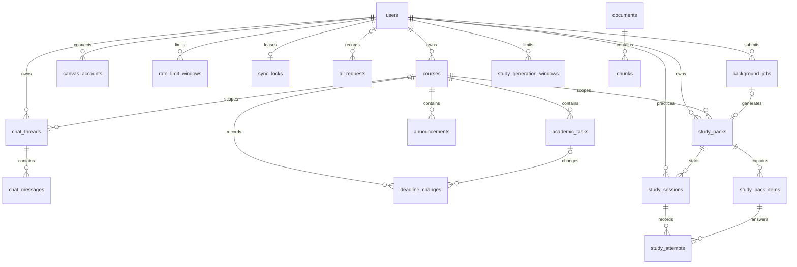

# User-provided schema context and ERD evidence

**Source:** schema supplied by project owner in this conversation, 27 November 2026.
**Classification:** contextual schema description, not independently queried production metadata.

> WARNING: This schema is for context only and is not meant to be run.
> Table order and constraints may not be valid for execution.

Full supplied table definitions are preserved in [USER_PROVIDED_SCHEMA_CONTEXT.sql](USER_PROVIDED_SCHEMA_CONTEXT.sql). **Do not execute this file.** Application schema/migrations and RAG SQLAlchemy definitions remain implementation evidence, not this contextual export.

## ERD

Diagram represents intended relationships. It does not assert that split foreign-key lines in the supplied export are executable or that all tables occupy one deployed database.

## All 22 supplied tables

| Table | Identity / important relationships |
|---|---|
| `users` | UUID PK; unique Clerk ID |
| `courses` | UUID PK; user FK; Canvas course ID and indexing metadata |
| `academic_tasks` | UUID PK; course FK; type/priority/status checks; manual flag |
| `announcements` | UUID PK; course FK; Canvas announcement ID |
| `canvas_accounts` | UUID PK; user FK; encrypted token and validation timestamps |
| `rate_limit_windows` | Composite PK user/window kind/start |
| `deadline_changes` | UUID PK; nullable task FK, required course FK |
| `ai_requests` | Identity bigint PK; nullable user FK; status/latency/cache metadata |
| `chat_threads` | UUID PK; user FK and optional course FK |
| `chat_messages` | UUID PK; thread FK; role/status checks and JSON metadata |
| `sync_locks` | User UUID PK/FK; lease token/expiry |
| `documents` | String PK; course key, Canvas course ID, owner/module/fingerprint |
| `chunks` | String PK; document FK; content/index and vector |
| `study_packs` | UUID PK; user/course ownership; optional unique background job FK |
| `study_pack_items` | UUID PK; pack FK; options/citations JSON and answer fields |
| `study_sessions` | UUID PK; pack/user ownership and progress |
| `study_attempts` | UUID PK; session/item FKs; answer/correctness/confidence |
| `course_modules` | Composite PK module ID/course key/owner |
| `deleted_account_ids` | Clerk ID hash PK; no reversible user identity asserted |
| `background_jobs` | UUID PK; user FK; payload/result/lease/retry/read state |
| `study_worker_heartbeats` | Worker UUID PK; last seen timestamp |
| `study_generation_windows` | Composite PK user/window kind/start |

## Interpretation and limitations

- Supplied `study_packs_course_id_user_id_fkey` and `study_sessions_pack_id_user_id_fkey` appear twice as separate single-column references. Repository migrations express ownership through composite constraints; do not execute or silently “repair” this export as production DDL.
- `embedding USER-DEFINED` omits the actual vector extension type/dimension. Runtime ORM uses pgvector and configured dimension; this export cannot establish vector compatibility.
- Database `study_packs.item_count` permits 1–50; current web request/worker validation permits **1–15**. Different layers have different bounds.
- RAG `ingestion_jobs` is absent from supplied context, though defined in backend source/migration. Indexes, RLS, grants, RPCs, triggers, unique indexes, cascading actions and migration history are not fully represented.
- `documents`, `chunks`, and `course_modules` appearing in one pasted `public` schema does not establish current physical database placement. Audit treats application and RAG stores as separate logical stores; deployment placement remains to be reconciled.
- The diagram deliberately uses actual table name **`study_pack_items`**; the earlier overview's `STUDY_ITEMS` is a logical shorthand.

## Implementation evidence

- [Application baseline](../../supabase/schema.sql)
- [Application migrations](../../supabase/migrations/)
- [Study persistence migration](../../supabase/migrations/202611140001_study_prep.sql)
- [RAG ORM snapshot](https://github.com/w1iii/CoursePilot-RAG/blob/c50770126f4f6c6a3d6120c56bfa6d6b0b41d494/app/vectorstore/schema.py)
- [RAG ingestion-job migration](https://github.com/w1iii/CoursePilot-RAG/blob/c50770126f4f6c6a3d6120c56bfa6d6b0b41d494/migrations/0005_ingestion_jobs.sql)
