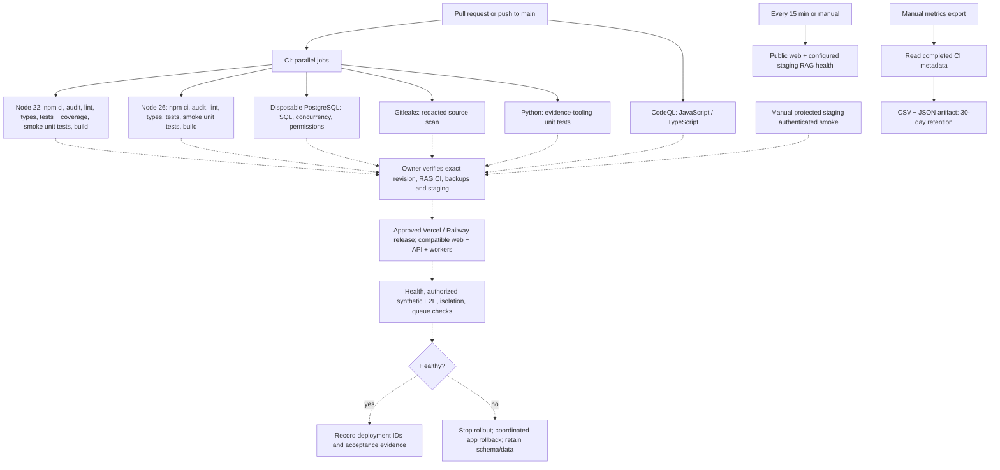

# CoursePilot pipeline

## Scope and source of truth

GitHub repository: `w1iii/CoursePilot`. Paths below are relative to that Git
root, not the parent `coursepilot-setup` workspace. Parent
`.github/workflows/ci.yml` is a separate monorepo-style configuration and is not
the workflow measured here. RAG lives in a separate repository; this web CI does
not certify its Python tests or container.

Backend-specific jobs, diagram and policy boundaries live in the
[RAG pipeline guide](https://github.com/w1iii/CoursePilot-RAG/blob/main/docs/devops/PIPELINE.md).
The completed metrics and optimization comparison in this pack concern web CI;
they are not backend performance measurements.

## Pipeline diagram

Solid paths represent configured automation. Dotted paths are operator-controlled
release gates/procedures, not dependencies enforced by the current workflows.
Standalone diagram source: [PIPELINE.mmd](PIPELINE.mmd).

## Triggers, jobs, and gates

| Configuration | Trigger | Behavior / boundary |
| --- | --- | --- |
| `.github/workflows/ci.yml` | PR; push to `main` | Node 22/26 matrix, database contracts, secret scan, evidence-tooling tests |
| `.github/workflows/codeql.yml` | PR; push to `main`; Monday 04:23 UTC | JavaScript/TypeScript static analysis |
| `.github/workflows/staging-auth-smoke.yml` | Manual | Protected `synthetic-staging` environment; 3-minute timeout |
| `.github/workflows/beta-availability.yml` | Every 15 minutes; manual | Web root HTTP 200 and configured staging RAG/database health; 3-minute timeout |
| `.github/workflows/pipeline-metrics.yml` | Manual | Read-only export of latest 40 CI candidates, retaining completed runs |
| `vercel.json` | Platform configuration | Daily `/api/cron/sync` schedule at 06:00 UTC; not a deployment workflow |

Web job order: checkout → Node/npm cache → locked install → high-severity audit
gate → lint → TypeScript → Vitest → staging-smoke script unit tests → Next build.
Both Node versions still run all these checks; only duplicate instrumentation
is removed on Node 26. Node 22 retains the configured 50% line-coverage threshold
for the `src/lib` inclusion scope. This is not a whole-application coverage claim.
Matrix default fail-fast remains enabled; a failing job can cancel its sibling.

Database checks invoke `npm run test:study-db`, which creates a uniquely named
disposable PostgreSQL 17 Docker container, applies selected schema/migrations,
and tests contracts/concurrency. It does not read project database credentials.
Secret scanning uses Gitleaks 8.30.1, repository configuration, redaction, and
`--no-git`: checked-out source only, not full Git history.

Web/database/secret/tooling timeouts are 15/10/5/3 minutes. CI uses
`contents: read` and cancels superseded runs per workflow/ref. npm caching was
already present before this change; no new build-output cache is claimed.

## Secrets and permissions

- Main CI needs no production secrets. Do not add service-role credentials to PR CI.
- Staging smoke reads `SYNTHETIC_SESSION_COOKIE` from the `synthetic-staging`
  environment. Its script targets the fixed staging hostname and does not follow
  redirects with the cookie. Provision a synthetic account and rotate credentials.
- Metrics export grants only `contents: read` and `actions: read`; passes the
  ephemeral GitHub token through `GH_TOKEN`. It does not read service logs.
- CodeQL's `security-events: write` is isolated to its existing workflow.
- Deployment secrets belong in approved platform/environment stores, not these
  documents, artifacts, PR output, or browser-public variables.

## Continuous delivery boundary

No GitHub deployment workflow or automatic CI-to-production promotion dependency
is configured in this pack. Existing Vercel/Railway Git integrations may deploy
independently; their settings and branch protection were not inspected or changed.
Do not assume green CI is required by platform deployment settings.

Release owner must verify required checks/rulesets and platform deployment
controls before enabling unattended releases. Follow
[DEPLOYMENT_ROLLBACK.md](DEPLOYMENT_ROLLBACK.md). Database changes require
separate review/approval; no workflow applies migrations automatically.

## Monitoring limitations

Availability currently checks `https://course-pilot-pi.vercel.app` and
`https://coursepilot-rag-staging.up.railway.app/health`. The staging-named RAG
endpoint is not proof it matches the active production API. Confirm current
web/API/worker attribution before release. Scheduled Actions can be delayed;
15 minutes is nominal cadence, not an alert latency SLA.

Root/health checks do not prove Clerk sign-in, Supabase availability, tenant
isolation, Canvas sync, worker progress, or LLM correctness. Manual staging smoke
checks authenticated course reads only. See [incident history](INCIDENT_LOG.md)
for the separately labeled alert-delivery drill.
